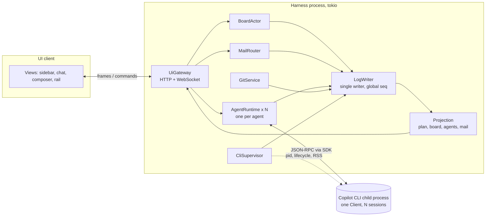

# Copilot harness: orchestration, messaging and UI wiring spec

This spec is for the agent that implements the harness. It tells you what to build and which Copilot Rust SDK API each piece relies on, and it marks clearly what is verified and what is design. The companion files are [harness-ui-mockup.html](../harness-ui-mockup.html), whose **Wiring** button labels every UI element with the IDs used in section 10, and [ui-wiring.json](ui-wiring.json), the machine-readable source of the section 10 tables. This revision (2026-10-13) reworked session lifecycle and token use after an end-to-end review; Appendix C lists every change.

## 0. How to read this spec

**Pinned sources.** All SDK links point to `github/copilot-sdk` commit `b19d3ef` (2026-10-13). Its `rust/src` is identical to the tag `rust/v1.0.21-preview.2`. The latest stable tag, `rust/v1.0.19`, is older. Pin one exact crate version and its bundled CLI before you write code, and re-check the links if you pin a different one. The prior-art links are pinned too: OpenCode `anomalyco/opencode@044d8b7d2e`, Codewhale `Hmbown/CodeWhale@008d21d`, and OpenChamber `main` (not pinned).

**Tags.** Every claim about an external system carries one of these:

| Tag | Meaning |
|---|---|
| **[SV]** | Verified in Copilot SDK source at the pinned commit. The link goes to the exact lines. |
| **[DOC]** | Taken from official docs. Not re-checked in source. |
| **[INF]** | A design choice made by this spec. It is intentional, not a fact about Copilot. |
| **[UNV]** | Depends on SDK behaviour that nobody has verified. Each one names a probe (V1–V18, section 11). Run the probe before code depends on it. |
| CLIENT / SAMPLE | UI-only state, or illustrative data in the mockup (section 10.6). |

## 1. Locked decisions

| # | Decision | Consequence in this spec |
|---|---|---|
| 1 | Layered topology: quick fire-and-forget subagents, plus long-lived teammates in team mode | `AgentKind::{Orchestrator, Quick, Teammate}` |
| 2 | A plan the user approves produces one session-wide task DAG. Updates are incremental, never whole-list rewrites. Each agent may keep a private checklist. | Board actor (section 6). `todo_write` stays private. |
| 3 | Messages flow in four directions: user → any agent, parent → running child, child → parent asks, peer ↔ peer | Mailbox (section 7) |
| 4 | One Copilot SDK session per agent, all on one `Client`. The harness owns orchestration. | Native fleet, tasks and custom agents are not used (section 3). |
| 5 | Each writing agent gets its own git worktree; readers share the main checkout | `Workspace::Worktree` |
| 6 | The orchestrator drafts the plan in read-only plan mode. The user edits and approves it. Re-plans that add, remove or rewire tasks also need approval. | Section 6.2 |
| 7 | The crash to eliminate is Copilot CLI/SDK session growth | Section 4. The 2026-10-13 review found that the reported failures are process heap exhaustion, very large logs (hundreds of MB), failing compaction and stalled event delivery, each with its own mitigation. |
| 8 | The UI is OpenChamber-like: inline agent cards in the parent chat, plus a right rail | Section 10 |
| 9 | **Revised 2026-10-13.** Copilot compacts each agent's context in place. An agent moves to a fresh Copilot session only on four failure triggers (failed compaction twice, no room after compaction, failed resume, a 256 MiB session workspace). The new session is seeded with Copilot's last compaction summary plus a harness brief of at most 8 KiB. The earlier event-count, size and time triggers are removed. | Sections 4.2 and 4.3 |
| 10 | No SDK callback waits on a human for more than 90 s. After that, a permission request is auto-rejected with feedback, its card stays open, and "Approve & retry" tells the agent to retry. | Sections 7.5 and 10, C13 |
| 11 | One Copilot CLI process for all agents, watched by a supervisor that **resumes** sessions after a crash or recycle | Section 4.4 |
| 12 | Peer messages are held and delivered as one digest at the recipient's next wake | Section 7.4 |

The spec also sets these defaults **[INF]**. Each can be changed.
- A user message to a running agent steers it (`Immediate`); the user can switch the message to queue instead.
- Quick subagents have depth 1.
- At most 8 turns run at once, and at most 16 sessions are live.
- A blocking tool waits once, for at most 60 s (`ask` defaults to 30 s), and never polls.
- A child's ask is escalated to the user when the parent is idle or `InputRequired` and has not answered it within 120 s of its next wake.
- Compaction starts at 80% of the context window or at 250,000 tokens, whichever comes first.

## 2. Architecture



| Component | Owns | Talks to Copilot through |
|---|---|---|
| **CliSupervisor** | The single `Client`. It polls RSS and session sizes, watches lifecycle, recycles the CLI and resumes sessions. | `Client::start`, `pid()`, `subscribe_lifecycle()`, `rpc().sessions().{get_sizes, close}`, `resume_session` |
| **AgentRuntime** (one per agent) | The agent's current Copilot session (its generation), a live subscriber, a durable `event_log` reader, its handlers and tools, and the rescue-rotation triggers | `prepare_session`, `send`, `abort`, `rpc().queue()`, `rpc().event_log()`, `rpc().history().compact_with_params`, handlers, hooks |
| **BoardActor** | Plan versions and the task DAG. It is the only writer. | `rpc().plan().update` (mirror only) |
| **MailRouter** | Mailboxes, delivery states, digests and escalation timers | `send` (via AgentRuntime), `rpc().queue()` |
| **LogWriter** | The global `seq`, segments, snapshots, blobs and the sparse index | none |
| **Projection** | In-memory state rebuilt from snapshot plus tail. Read by every component and served to the UI. | none |
| **GitService** | Worktrees, `numstat`, per-edit snapshots (D9) | none |
| **UiGateway** | The REST, command and WebSocket API of section 10.1 | none |

The data flow has two halves.
- **Copilot to UI:** Copilot events go to AgentRuntime, which normalizes them into an `EventEnvelope`. The LogWriter assigns the next `seq` and commits the envelope; only ephemeral frames skip the write. The Projection is updated, and the UiGateway broadcasts the envelope.
- **UI to Copilot:** UI commands go to the UiGateway, then to BoardActor, MailRouter or AgentRuntime. They emit events, and an SDK call follows if one is needed. A command is acknowledged only after its event commits.

## 3. Copilot Rust SDK surface used

All entries below were checked in the source at the pinned commit **[SV]** unless tagged otherwise.

| Need | SDK API | Harness use | Source |
|---|---|---|---|
| One CLI process | `Client::start(ClientOptions)`. It spawns `copilot --server --stdio --no-auto-update` and routes sessions by id over that one connection. | One `Client` for the whole harness | [lib.rs#L1332](https://github.com/github/copilot-sdk/blob/b19d3ef043ebfeaeb794339173c39ad6c8eb29ca/rust/src/lib.rs#L1332) |
| Liveness | `Client::pid()`, `Client::subscribe_lifecycle()` | Supervisor | [lib.rs#L3053](https://github.com/github/copilot-sdk/blob/b19d3ef043ebfeaeb794339173c39ad6c8eb29ca/rust/src/lib.rs#L3053), [lib.rs#L3328](https://github.com/github/copilot-sdk/blob/b19d3ef043ebfeaeb794339173c39ad6c8eb29ca/rust/src/lib.rs#L3328) |
| Session per agent | `Client::prepare_session(SessionConfig)` → `PreparedSession::subscribe()` → `start()` | Subscribe before `start` so no early event is lost | [session.rs#L1632](https://github.com/github/copilot-sdk/blob/b19d3ef043ebfeaeb794339173c39ad6c8eb29ca/rust/src/session.rs#L1632), [#L2509](https://github.com/github/copilot-sdk/blob/b19d3ef043ebfeaeb794339173c39ad6c8eb29ca/rust/src/session.rs#L2509), [#L2531](https://github.com/github/copilot-sdk/blob/b19d3ef043ebfeaeb794339173c39ad6c8eb29ca/rust/src/session.rs#L2531) |
| Agent configuration | `SessionConfig{model, provider, working_directory, tools, available_tools, excluded_tools, excluded_builtin_agents, infinite_sessions, include_sub_agent_streaming_events, permission_handler, user_input_handler, exit_plan_mode_handler, hooks_handler, event_buffer_capacity, …}` | One config per agent | [types.rs#L2064-L2476](https://github.com/github/copilot-sdk/blob/b19d3ef043ebfeaeb794339173c39ad6c8eb29ca/rust/src/types.rs#L2064-L2476) |
| BYOK | `ProviderConfig{provider_type, base_url (required), api_key, bearer_token, wire_api, …}` | Per-agent provider profile, supplied again on every create and resume. "Model required with BYOK" and "keys not persisted" are **[DOC]**. | [types.rs#L1295-L1317](https://github.com/github/copilot-sdk/blob/b19d3ef043ebfeaeb794339173c39ad6c8eb29ca/rust/src/types.rs#L1295-L1317) |
| Compaction thresholds | `InfiniteSessionConfig{background_compaction_threshold` (default 0.80), `buffer_exhaustion_threshold` (default 0.95)`}` | Set `min(0.80, 250_000 / token_limit)` and 0.95 (section 4.2) | [types.rs#L1001-L1012](https://github.com/github/copilot-sdk/blob/b19d3ef043ebfeaeb794339173c39ad6c8eb29ca/rust/src/types.rs#L1001-L1012) |
| Send | `Session::send(MessageOptions{prompt, mode, agent_mode, attachments, display_prompt, …})`. It returns a message id. | All agent input | [session.rs#L842](https://github.com/github/copilot-sdk/blob/b19d3ef043ebfeaeb794339173c39ad6c8eb29ca/rust/src/session.rs#L842), [types.rs#L5913-L5953](https://github.com/github/copilot-sdk/blob/b19d3ef043ebfeaeb794339173c39ad6c8eb29ca/rust/src/types.rs#L5913-L5953) |
| Delivery | `DeliveryMode::{Enqueue, Immediate}`. The echo `user.message.delivery` is one of `idle`, `steering`, `queued`. | Mail delivery states | [types.rs#L5858-L5862](https://github.com/github/copilot-sdk/blob/b19d3ef043ebfeaeb794339173c39ad6c8eb29ca/rust/src/types.rs#L5858-L5862), [session_events.rs#L10053-L10066](https://github.com/github/copilot-sdk/blob/b19d3ef043ebfeaeb794339173c39ad6c8eb29ca/rust/src/generated/session_events.rs#L10053-L10066) |
| Queue (experimental) | `rpc().queue().{pending_items, send_now, withdraw_message, remove_at, append_steering, set_drain_paused, clear, …}` | Send now and Retract. Reconcile on `pending_messages.modified`. | [rpc.rs#L15511](https://github.com/github/copilot-sdk/blob/b19d3ef043ebfeaeb794339173c39ad6c8eb29ca/rust/src/generated/rpc.rs#L15511), [#L15825](https://github.com/github/copilot-sdk/blob/b19d3ef043ebfeaeb794339173c39ad6c8eb29ca/rust/src/generated/rpc.rs#L15825), [#L15697](https://github.com/github/copilot-sdk/blob/b19d3ef043ebfeaeb794339173c39ad6c8eb29ca/rust/src/generated/rpc.rs#L15697), [#L15631](https://github.com/github/copilot-sdk/blob/b19d3ef043ebfeaeb794339173c39ad6c8eb29ca/rust/src/generated/rpc.rs#L15631) |
| Stop | `Session::abort()`, `Session::disconnect()` (idle sessions only) | Stop an agent | [session.rs#L1109](https://github.com/github/copilot-sdk/blob/b19d3ef043ebfeaeb794339173c39ad6c8eb29ca/rust/src/session.rs#L1109), [#L1345](https://github.com/github/copilot-sdk/blob/b19d3ef043ebfeaeb794339173c39ad6c8eb29ca/rust/src/session.rs#L1345) |
| Close and resume | `rpc().sessions().close(SessionsCloseRequest{session_id})` emits `session.shutdown`, flushes and releases the lock. `Client::resume_session` / `prepare_resume_session` reopen a session with its full context. | Retire a generation; recover after a CLI restart (4.3, 4.4) | [rpc.rs#L5918](https://github.com/github/copilot-sdk/blob/b19d3ef043ebfeaeb794339173c39ad6c8eb29ca/rust/src/generated/rpc.rs#L5918), [api_types.rs#L26269-L26275](https://github.com/github/copilot-sdk/blob/b19d3ef043ebfeaeb794339173c39ad6c8eb29ca/rust/src/generated/api_types.rs#L26269-L26275), [session.rs#L1655](https://github.com/github/copilot-sdk/blob/b19d3ef043ebfeaeb794339173c39ad6c8eb29ca/rust/src/session.rs#L1655), [#L1725](https://github.com/github/copilot-sdk/blob/b19d3ef043ebfeaeb794339173c39ad6c8eb29ca/rust/src/session.rs#L1725) |
| Session size | `rpc().sessions().get_sizes()` → `SessionSizes{sizes: session id → bytes of the session's workspace directory}` | RT4, polled every 60 s | [rpc.rs#L5825](https://github.com/github/copilot-sdk/blob/b19d3ef043ebfeaeb794339173c39ad6c8eb29ca/rust/src/generated/rpc.rs#L5825), [api_types.rs#L26980-L26982](https://github.com/github/copilot-sdk/blob/b19d3ef043ebfeaeb794339173c39ad6c8eb29ca/rust/src/generated/api_types.rs#L26980-L26982) |
| On-demand compaction | `rpc().history().compact()` and `compact_with_params(HistoryCompactRequest{custom_instructions, token_limit, trigger})` → `HistoryCompactResult{success, summary_content, tokens_removed, messages_removed, context_window}` | Optional compaction at task boundaries (4.2, probe V7) | [rpc.rs#L10777](https://github.com/github/copilot-sdk/blob/b19d3ef043ebfeaeb794339173c39ad6c8eb29ca/rust/src/generated/rpc.rs#L10777), [#L10806](https://github.com/github/copilot-sdk/blob/b19d3ef043ebfeaeb794339173c39ad6c8eb29ca/rust/src/generated/rpc.rs#L10806), [api_types.rs#L9562-L9600](https://github.com/github/copilot-sdk/blob/b19d3ef043ebfeaeb794339173c39ad6c8eb29ca/rust/src/generated/api_types.rs#L9562-L9600) |
| Compaction result | `session.compaction_complete{success, error, pre_compaction_tokens, post_compaction_tokens, token_limit, messages_removed, summary_content, compaction_tokens_used{input_tokens, output_tokens, cache_read_tokens, duration}, …}` | RT1, RT2, handoff seed, C16 cost | [session_events.rs#L2579-L2652](https://github.com/github/copilot-sdk/blob/b19d3ef043ebfeaeb794339173c39ad6c8eb29ca/rust/src/generated/session_events.rs#L2579-L2652), [#L2527-L2562](https://github.com/github/copilot-sdk/blob/b19d3ef043ebfeaeb794339173c39ad6c8eb29ca/rust/src/generated/session_events.rs#L2527-L2562) |
| Token and cache accounting | `assistant.usage{input_tokens, output_tokens, cache_read_tokens, cache_write_tokens, is_byok, …}`; `session.usage_info{current_tokens, token_limit, system_tokens, tool_definitions_tokens, …}` | D5, D7, probe V17 | [session_events.rs#L4009-L4123](https://github.com/github/copilot-sdk/blob/b19d3ef043ebfeaeb794339173c39ad6c8eb29ca/rust/src/generated/session_events.rs#L4009-L4123), [#L2431-L2449](https://github.com/github/copilot-sdk/blob/b19d3ef043ebfeaeb794339173c39ad6c8eb29ca/rust/src/generated/session_events.rs#L2431-L2449) |
| Live events | `Session::subscribe()` is a tokio broadcast. `DEFAULT_EVENT_BUFFER_CAPACITY = 512`; a reader that falls behind gets `Lagged(n)` and loses the oldest events. | Fallback reader only if V9 fails (section 4.5), capacity 2,048 | [session.rs#L62](https://github.com/github/copilot-sdk/blob/b19d3ef043ebfeaeb794339173c39ad6c8eb29ca/rust/src/session.rs#L62), [#L758](https://github.com/github/copilot-sdk/blob/b19d3ef043ebfeaeb794339173c39ad6c8eb29ca/rust/src/session.rs#L758), [subscription.rs#L60](https://github.com/github/copilot-sdk/blob/b19d3ef043ebfeaeb794339173c39ad6c8eb29ca/rust/src/subscription.rs#L60) |
| Event log (experimental) | `rpc().event_log().read(EventLogReadRequest{cursor, direction, max, include_ephemeral, wait_ms, …})` → `EventsReadResult{cursor, cursor_status, events, has_more}`; `tail()` | The single ingest loop, with `include_ephemeral: true` (section 4.5) | [rpc.rs#L10139](https://github.com/github/copilot-sdk/blob/b19d3ef043ebfeaeb794339173c39ad6c8eb29ca/rust/src/generated/rpc.rs#L10139), [#L10165](https://github.com/github/copilot-sdk/blob/b19d3ef043ebfeaeb794339173c39ad6c8eb29ca/rust/src/generated/rpc.rs#L10165), [api_types.rs#L8108-L8132](https://github.com/github/copilot-sdk/blob/b19d3ef043ebfeaeb794339173c39ad6c8eb29ca/rust/src/generated/api_types.rs#L8108-L8132), [#L8175](https://github.com/github/copilot-sdk/blob/b19d3ef043ebfeaeb794339173c39ad6c8eb29ca/rust/src/generated/api_types.rs#L8175) |
| Event envelope | `SessionEvent{id, timestamp, parent_id, ephemeral, agent_id, event_type, data}` | `Origin::Copilot` fields; `id` is the idempotency key | [types.rs#L6124-L6146](https://github.com/github/copilot-sdk/blob/b19d3ef043ebfeaeb794339173c39ad6c8eb29ca/rust/src/types.rs#L6124-L6146) |
| Event payloads | Wire names are declared at [session_events.rs#L14-L574](https://github.com/github/copilot-sdk/blob/b19d3ef043ebfeaeb794339173c39ad6c8eb29ca/rust/src/generated/session_events.rs#L14-L574). The payloads used are listed per UI element in section 10. | Normalization | — |
| Tools | `Tool::new(name).with_description(..).with_parameters(json).with_handler(Arc<dyn ToolHandler>)`. The handler receives `ToolInvocation{session_id, tool_call_id, tool_name, arguments}`. | The 14 harness tools | [types.rs#L432-L522](https://github.com/github/copilot-sdk/blob/b19d3ef043ebfeaeb794339173c39ad6c8eb29ca/rust/src/types.rs#L432-L522), [#L6189-L6195](https://github.com/github/copilot-sdk/blob/b19d3ef043ebfeaeb794339173c39ad6c8eb29ca/rust/src/types.rs#L6189-L6195), [tool.rs#L227-L230](https://github.com/github/copilot-sdk/blob/b19d3ef043ebfeaeb794339173c39ad6c8eb29ca/rust/src/tool.rs#L227-L230) |
| Permissions | `PermissionHandler::handle(session_id, request_id, PermissionRequestData{kind, tool_call_id, extra})` → `PermissionResult::{approve_once(), reject(feedback), user_not_available(), no_result()}`. The wire `PermissionDecision` also has `ApproveForSession`, `ApproveForLocation`, `ApproveReadOnlyForSession`, `ApprovePermanently` and `Cancelled`. | Permission card | [handler.rs#L54-L131](https://github.com/github/copilot-sdk/blob/b19d3ef043ebfeaeb794339173c39ad6c8eb29ca/rust/src/handler.rs#L54-L131), [#L204-L211](https://github.com/github/copilot-sdk/blob/b19d3ef043ebfeaeb794339173c39ad6c8eb29ca/rust/src/handler.rs#L204-L211), [api_types.rs#L48500-L48511](https://github.com/github/copilot-sdk/blob/b19d3ef043ebfeaeb794339173c39ad6c8eb29ca/rust/src/generated/api_types.rs#L48500-L48511) |
| Built-in ask-user | `UserInputHandler`, which receives `user_input.requested{question, choices, allow_freeform}` and returns `UserInputResponse{answer, was_freeform}` | Turned into Ask mail | [handler.rs#L149](https://github.com/github/copilot-sdk/blob/b19d3ef043ebfeaeb794339173c39ad6c8eb29ca/rust/src/handler.rs#L149), [#L303](https://github.com/github/copilot-sdk/blob/b19d3ef043ebfeaeb794339173c39ad6c8eb29ca/rust/src/handler.rs#L303), [session_events.rs#L7638-L7651](https://github.com/github/copilot-sdk/blob/b19d3ef043ebfeaeb794339173c39ad6c8eb29ca/rust/src/generated/session_events.rs#L7638-L7651) |
| Exit plan mode | `ExitPlanModeHandler` receives `ExitPlanModeData{summary, plan_content, actions, recommended_action}` and returns `ExitPlanModeResult{approved, selected_action, feedback}` | Turns `plan_content` into a draft plan and returns at once with `approved: false`, so nothing waits on a human (section 6.2) | [handler.rs#L159](https://github.com/github/copilot-sdk/blob/b19d3ef043ebfeaeb794339173c39ad6c8eb29ca/rust/src/handler.rs#L159), [#L318](https://github.com/github/copilot-sdk/blob/b19d3ef043ebfeaeb794339173c39ad6c8eb29ca/rust/src/handler.rs#L318) |
| Plan mode | `MessageOptions.agent_mode = AgentMode::Plan`; `rpc().mode().set(..)` | Orchestrator's planning phase | [types.rs#L5872-L5880](https://github.com/github/copilot-sdk/blob/b19d3ef043ebfeaeb794339173c39ad6c8eb29ca/rust/src/types.rs#L5872-L5880), [rpc.rs#L13215](https://github.com/github/copilot-sdk/blob/b19d3ef043ebfeaeb794339173c39ad6c8eb29ca/rust/src/generated/rpc.rs#L13215) |
| Plan mirror | `rpc().plan().update(PlanUpdateRequest)` | Mirrors the approved markdown | [rpc.rs#L14562](https://github.com/github/copilot-sdk/blob/b19d3ef043ebfeaeb794339173c39ad6c8eb29ca/rust/src/generated/rpc.rs#L14562) |
| Hooks | `hooks_handler: Arc<dyn SessionHooks>`. `PreToolUseOutput{permission_decision, permission_decision_reason, additional_context}`; `PostToolUseOutput{additional_context}`. `HookContext` carries only the session id. | Denying writes to readers; unread-mail nudges. Open Rust hook bugs #2781 and #2794 (probe V14). | [hooks.rs#L19](https://github.com/github/copilot-sdk/blob/b19d3ef043ebfeaeb794339173c39ad6c8eb29ca/rust/src/hooks.rs#L19), [#L44-L56](https://github.com/github/copilot-sdk/blob/b19d3ef043ebfeaeb794339173c39ad6c8eb29ca/rust/src/hooks.rs#L44-L56), [#L123-L129](https://github.com/github/copilot-sdk/blob/b19d3ef043ebfeaeb794339173c39ad6c8eb29ca/rust/src/hooks.rs#L123-L129) |
| Handoff helper | `rpc().history().summarize_for_handoff()` returns a Markdown summary "produced by an LLM" | **Not used.** It makes an extra model call; the last compaction's `summary_content` is already paid for (4.3). | [rpc.rs#L11022](https://github.com/github/copilot-sdk/blob/b19d3ef043ebfeaeb794339173c39ad6c8eb29ca/rust/src/generated/rpc.rs#L11022) |
| Built-in tool list | `rpc().tools().get_builtin_descriptors()` | Verb table; read-only exclusion lists. The names are **[UNV]** (V8). | [rpc.rs#L17586](https://github.com/github/copilot-sdk/blob/b19d3ef043ebfeaeb794339173c39ad6c8eb29ca/rust/src/generated/rpc.rs#L17586) |
| Model | `Session::set_model`; event `session.model_change{new_model}` | Model chip | [session.rs#L1122](https://github.com/github/copilot-sdk/blob/b19d3ef043ebfeaeb794339173c39ad6c8eb29ca/rust/src/session.rs#L1122), [session_events.rs#L1591-L1647](https://github.com/github/copilot-sdk/blob/b19d3ef043ebfeaeb794339173c39ad6c8eb29ca/rust/src/generated/session_events.rs#L1591-L1647) |

**Do not use:**
- `Session::get_events()` ([session.rs#L1084](https://github.com/github/copilot-sdk/blob/b19d3ef043ebfeaeb794339173c39ad6c8eb29ca/rust/src/session.rs#L1084)). It loads the whole timeline into one `Vec`.
- `rpc().fleet().start`. It has no status or cancel.
- `rpc().tasks()`.
- Native `custom_agents` ([types.rs#L2272](https://github.com/github/copilot-sdk/blob/b19d3ef043ebfeaeb794339173c39ad6c8eb29ca/rust/src/types.rs#L2272)).
- `include_sub_agent_streaming_events: true`.
- `resume_session` on a session whose workspace is at or above the RT4 size (section 4.3).
- `disconnect()` on a busy session. Its docs require the session to be idle. Retire generations with `sessions().close` at a safe point.
- `history().clear_context`. It must be called from inside a tool handler and is not needed in v1.

## 4. Session lifecycle and token budget

The rule of this section: **keep an agent in its Copilot session for as long as the session is healthy, and let Copilot compact it in place.** A fresh session (a new *generation*) is a rescue for four specific failures. It is never a routine event. Every surveyed harness works this way (4.2), and the crash reports show failures at sizes far beyond what a busy agent reaches in a working day (4.1).

### 4.1 What actually breaks long Copilot sessions

Numbers come from the issue bodies and comments, read on 2026-10-13 ([copilot_issue_evidence.md](../research_notes/Copilot%20harness%20limits%20review/copilot_issue_evidence.md)). Behaviour of the CLI itself comes from a read-only inspection of the shipped 1.0.97-2 package, whose session logic is a compiled native module, so most numeric constants are not visible ([copilot_cli_internals.md](../research_notes/Copilot%20harness%20limits%20review/copilot_cli_internals.md)). "Status" refers to CLI 1.0.97-2, the version the pinned SDK downloads (`copilotCliVersion` in the SDK's `nodejs/package.json`).

| Failure | Reported scale | Issues | Status | Mitigation in this spec |
|---|---|---|---|---|
| The process runs out of memory (Node heap cap about 4 GiB) from leaks and from retention. The inspection indicates that the runtime keeps each live session's durable event log in memory and that resume reloads all of it **[INF]**, so V16 measures it. | OOM after 37 min with 31,965 leaked async handles; heap 3.98 of 4.00 GiB at RSS 4.6 GiB; a 24 h run with 825 compactions | [#4686](https://github.com/github/copilot-cli/issues/4686), [#4699](https://github.com/github/copilot-cli/issues/4699), [#4725](https://github.com/github/copilot-cli/issues/4725) | Open. 1.0.97-0 adds "emergency memory relief" that compacts instead of aborting. | Supervisor recycles the process and **resumes** every session (4.4) |
| Loading a very large `events.jsonl` on resume or startup | Fails at 559,508,763 B and 1,664,072,585 B (V8's 512 MiB string limit); loads at 429,424,287 B; about 70 min of CPU to resume about 532 MB; OOM with 2.8 GiB and 1.7 GiB logs | [#4325](https://github.com/github/copilot-cli/issues/4325), [#4717](https://github.com/github/copilot-cli/issues/4717), [#4251](https://github.com/github/copilot-cli/issues/4251), [#4699](https://github.com/github/copilot-cli/issues/4699) | #4325 and #4717 are closed. The 1.0.88 release notes say resuming large sessions "keeps transcript memory bounded". | RT4: a new generation once the session workspace reaches 256 MiB (4.3) |
| Compaction fails or loops | 131 compactions with 110 failed, the summarizer timing out at 300 s on 840K-token inputs; 38 of 38 failed and retried every turn; OOM while compacting a 1.6 MB, 437-event session | [#5054](https://github.com/github/copilot-cli/issues/5054), [#4663](https://github.com/github/copilot-cli/issues/4663), [#4780](https://github.com/github/copilot-cli/issues/4780), [#4138](https://github.com/github/copilot-cli/issues/4138) | Open | An absolute cap on the compaction threshold (4.2); RT1 after two failures in a row (4.3) |
| Event delivery stops for good after one 120 s host-ack timeout | Sessions of about 100 MB with about 4,000 tool calls; a 5 s permission-ack variant | [#5100](https://github.com/github/copilot-cli/issues/5100), [#5018](https://github.com/github/copilot-cli/issues/5018) | Open, reproduced on 1.0.96-2 | No handler waits more than 90 s (decision 10). A stalled session is treated as a crash and recycled (4.4). |
| Each event costs an open, append and close, which Windows Defender rescans | "tens–hundreds of times per second" (reporter's estimate) | [#4063](https://github.com/github/copilot-cli/issues/4063), [#5035](https://github.com/github/copilot-cli/issues/5035) | Open, but 1.0.97-2 writes through a native buffered writer with a 100 ms debounce | Fewer CLI events: no sub-agent streaming, native agents excluded |
| An inherited file-size rlimit stops `events.jsonl` (EFBIG at a 50 MB host limit) | — | [copilot-sdk #2261](https://github.com/github/copilot-sdk/issues/2261) | Open | Start the CLI without a file-size rlimit |
| A stale `inuse.<pid>.lock` blocks resume after a crash | 14 of 184 local sessions | [#4805](https://github.com/github/copilot-cli/issues/4805) | Open | Clean shutdown uses `sessions().close`, which releases the lock. After a crash, a resume that fails on the lock becomes RT3. Stale locks are reported, never deleted. |
| Unbounded Rust JSON-RPC queues | — | [copilot-sdk #2510](https://github.com/github/copilot-sdk/issues/2510) | Open | Fast consumers; capacity limits (4.4) |

Across three of these reports a stored event averages 3.0 to 3.7 KB: 934,639,321 B for 282,912 events ([#4639](https://github.com/github/copilot-cli/issues/4639)), 38.6 MB for about 13,000 (#4805), and 1.6 MB for 437 (#4780). The earlier draft of this spec rotated at 3,000 events (about 10 MB) or 32 MiB. The smallest reported load failure was 559,508,763 B, which is 17 times 32 MiB and about 56 times 10 MB. The old triggers bought no safety and paid for a handoff every hour or two of busy work. Both triggers are removed.

### 4.2 Context: compact in place [SV + INF]

Context is handled by Copilot's infinite sessions. When `current_tokens / token_limit` crosses `background_compaction_threshold`, the CLI summarizes older history in the background. At `buffer_exhaustion_threshold` it blocks the turn until compaction finishes ([types.rs#L1001-L1012](https://github.com/github/copilot-sdk/blob/b19d3ef043ebfeaeb794339173c39ad6c8eb29ca/rust/src/types.rs#L1001-L1012)). The harness sets:

- `background_compaction_threshold = min(0.80, 250_000 / window)`, where `window` is the context window that the harness provider profile **must declare** (`context_window_tokens`). It has to be known before the session exists, because `InfiniteSessionConfig` is set on create and resume. The harness also passes it to Copilot as `ProviderConfig.max_prompt_tokens` ([types.rs#L1351-L1356](https://github.com/github/copilot-sdk/blob/b19d3ef043ebfeaeb794339173c39ad6c8eb29ca/rust/src/types.rs#L1351-L1356)). If the first `session.usage_info.token_limit` differs, the harness logs `Health` and uses the smaller value from the next generation on. 0.80 is the SDK default. The absolute cap keeps the summarizer's input small enough to finish: #5054 timed out at 300 s on 840K-token inputs, and its last success took 209 s. Goose uses the same shape of rule, 0.8 of the window or 225,000 tokens, whichever comes first. For a 200K window this gives 0.80 (160K tokens), for 400K it gives 0.625, and for 1M it gives 0.25.
- `buffer_exhaustion_threshold = 0.95`, the SDK default.

Probe V18 checks both against each BYOK profile. If compaction on a profile takes more than 120 s or fails, lower that profile's cap.

**What other harnesses do.** None of the ten surveyed harnesses starts a fresh session on an event count, log size or elapsed time. All of them compact in place on a token threshold. Handoff to a new context exists only as a user or model action. Sources are in [the harness notes](../research_notes/Copilot%20harness%20limits%20review/harnesses_claude_codex_gemini_opencode.md) and [the second harness notes](../research_notes/Copilot%20harness%20limits%20review/harnesses_amp_cline_roo_goose_aider_codewhale.md).

| Harness | Automatic compaction trigger | Fresh session or handoff |
|---|---|---|
| Claude Code | Near the model's context limit; `CLAUDE_CODE_AUTO_COMPACT_WINDOW` and `CLAUDE_AUTOCOMPACT_PCT_OVERRIDE` lower it ([model-config](https://code.claude.com/docs/en/model-config)) | Only `/clear`, and a resume-from-summary dialog the user answers |
| Codex CLI | 90% of the window ([openai_models.rs](https://github.com/openai/codex/blob/90f00bd89ed3263b4d5993849cccb795f4330449/codex-rs/protocol/src/openai_models.rs#L529-L540)) | Opt-in `token_budget` mode, token-triggered |
| Gemini CLI | 50% of the token limit; keeps the latest 30% verbatim ([chatCompressionService.ts](https://github.com/google-gemini/gemini-cli/blob/51617c1bcbcb038291125b092501b4342f4e7f77/packages/core/src/context/chatCompressionService.ts#L42-L45)) | None |
| OpenCode | Window minus the larger of 10% and 16,000 tokens; keeps 15,000 tokens verbatim ([compaction.ts](https://github.com/anomalyco/opencode/blob/044d8b7d2e/packages/core/src/session/compaction.ts#L901-L911), [#L195-L197](https://github.com/anomalyco/opencode/blob/044d8b7d2e/packages/core/src/session/compaction.ts#L195-L197)) | None |
| Goose | 0.8 of the window or 225,000 tokens, whichever is lower ([mod.rs](https://github.com/block/goose/blob/main/crates/goose/src/context_mgmt/mod.rs#L27)) | None |
| Codewhale | 80% of the route's input window ([settings.rs](https://github.com/Hmbown/CodeWhale/blob/008d21d69fa14d93a36a749b6afedd17d706c8cb/crates/tui/src/settings.rs#L542)) | `/relay` writes a model-written handoff on request |
| Roo Code | 100% by default, with a manual button ([Task.ts](https://github.com/RooCodeInc/Roo-Code/blob/main/src/core/task/Task.ts#L3887)) | None |
| Aider | Chat history over `min(max(window/16, 1024), 8192)` tokens, summarized by the weak model ([models.py](https://github.com/Aider-AI/aider/blob/main/aider/models.py#L356)) | None |
| Cline | "When the conversation approaches the context window limit"; no number published | `new_task`, approved by the user |
| Amp | No compaction | `/handoff`, which the user runs and edits ([news](https://ampcode.com/news/handoff)) |

**Cost of a compaction.** One summarizer call on the session's own model (BYOK included) reads the system prompt, the whole conversation and a summarization prompt, with the tools still attached under `tool_choice: none`. It writes a structured summary and a checkpoint. Because the request reuses the session's cache markers, its input is mostly cache reads; the next request writes the shorter history to the cache ([copilot_cli_internals.md](../research_notes/Copilot%20harness%20limits%20review/copilot_cli_internals.md), from the SDK's compaction e2e test). With list prices of October 2026, the model gives about $0.06 to $0.17 per compaction for 128K to 200K windows on Claude Sonnet 5.5 and GPT-5.6-sol ([token_economics.md](../research_notes/Copilot%20harness%20limits%20review/token_economics.md); modelled, not measured). Each `session.compaction_complete` reports the real cost in `compaction_tokens_used{input_tokens, output_tokens, cache_read_tokens, duration}` **[SV]** ([session_events.rs#L2527-L2562](https://github.com/github/copilot-sdk/blob/b19d3ef043ebfeaeb794339173c39ad6c8eb29ca/rust/src/generated/session_events.rs#L2527-L2562)), and the compaction divider (C16) shows it.

**Optional, after probe V7: steer compaction at task boundaries.** When a teammate completes a task above 50% of its window, the harness can call `history().compact_with_params(HistoryCompactRequest{custom_instructions, ..})` **[SV]** ([rpc.rs#L10806](https://github.com/github/copilot-sdk/blob/b19d3ef043ebfeaeb794339173c39ad6c8eb29ca/rust/src/generated/rpc.rs#L10806), [api_types.rs#L9562-L9600](https://github.com/github/copilot-sdk/blob/b19d3ef043ebfeaeb794339173c39ad6c8eb29ca/rust/src/generated/api_types.rs#L9562-L9600)) before sending the next task brief. The instructions would be "Keep repository facts, conventions and open questions. Drop the details of finished task T3." This costs the same as a background compaction, but it happens between tasks instead of in the middle of one.

### 4.3 Rescue rotation to a new generation [INF]

Each `AgentRecord` holds a `CopilotBinding{session_id, generation, …}`. The AgentRuntime starts a new generation **only** on these triggers:

| Trigger | Fires when | Why |
|---|---|---|
| **RT1** `CompactionFailedTwice` | Two `session.compaction_complete{success: false}` in a row in this generation | The CLI retries a failed compaction on its own, and each attempt is a full summarizer call (#4663: 38 of 38 failed). Two failures in a row show it will not recover. |
| **RT2** `NoRoomAfterCompaction` | A successful compaction leaves `post_compaction_tokens / token_limit ≥ 0.90` | Compaction cannot free space, usually because of pinned huge content, so the session can no longer work |
| **RT3** `ResumeFailed` | `resume_session` fails after a CLI restart (4.4), for example because of a stale lock | The context is unreachable |
| **RT4** `WorkspaceTooLarge` | `sessions().get_sizes()` reports at least **256 MiB** for the session, or the memory rule of 4.4 selects it | Half of V8's 512 MiB string limit and below every reported load failure (the smallest was 559,508,763 B). At about 3.3 KB per event that is roughly 80,000 events, so in practice it is a backstop. Probe V16 calibrates it. |

These triggers were **removed** from the earlier draft:
- **3,000 events.** It fires after roughly 250 to 500 tool calls and protects nothing (4.1).
- **32 MiB of `events.jsonl`.** This is far below the failure sizes. It also could not be read while a session was live: `events_file_size_bytes` exists only on `session.shutdown` and `session.resume` ([session_events.rs#L2167](https://github.com/github/copilot-sdk/blob/b19d3ef043ebfeaeb794339173c39ad6c8eb29ca/rust/src/generated/session_events.rs#L2167)), and the file-path RPC is `pub(crate)` ([rpc.rs#L5798](https://github.com/github/copilot-sdk/blob/b19d3ef043ebfeaeb794339173c39ad6c8eb29ca/rust/src/generated/rpc.rs#L5798)). RT4 uses the public `sessions().get_sizes()` instead ([rpc.rs#L5825](https://github.com/github/copilot-sdk/blob/b19d3ef043ebfeaeb794339173c39ad6c8eb29ca/rust/src/generated/rpc.rs#L5825), [api_types.rs#L26980-L26982](https://github.com/github/copilot-sdk/blob/b19d3ef043ebfeaeb794339173c39ad6c8eb29ca/rust/src/generated/api_types.rs#L26980-L26982)). That figure is the whole session directory, so it is an upper bound on `events.jsonl`.
- **A second successful compaction.** A successful compaction is the CLI working as designed. Rotating after one throws away an LLM-written summary that was already paid for, along with the warm prompt cache.
- **4 h of wall time.** No harness or issue supports it, and firing it on an idle agent would wake that agent for nothing.

**Protocol.** Nothing is torn down mid-turn.
1. **Hold mail at once.** As soon as a trigger fires, the harness sets `CopilotBinding.rotation_pending`, and MailRouter holds all new mail for the agent. It calls `queue().set_drain_paused(true)`, then calls `withdraw_message{message_id, expected_prompt}` for every harness-owned item in `pending_items()` and sets that mail back to `Held`. Nothing new can keep a failing session busy.
2. **Wait for a safe point.** That is the end of the current turn (`session.idle`) with no handler held. If none comes within **5 minutes**, the harness calls `abort()` and waits for `session.idle`. On RT1 and RT2 every extra turn retries a failing compaction, so waiting longer only burns tokens. If the agent is already idle, rotation is **lazy**: the new session is built at the agent's next real wake, and the handoff goes into that wake's message, so it costs one turn instead of two.
3. **Drain.** Read `event_log()` with `wait_ms: 0` until `has_more == false`, so the old generation's last events are committed.
4. **Build the handoff, at most 8 KiB (about 2,000 tokens).** Each part has a budget:
   - **3 KiB:** the latest compaction `summary_content`. It costs nothing extra because the compaction already paid for it. `CopilotBinding.last_summary` carries over from earlier generations, so a generation that never compacted successfully hands on the previous one's summary.
   - **1.5 KiB:** owned tasks as id, title, status and last note.
   - **1 KiB:** unread mail as id, sender and summary, at most 10 entries.
   - **1 KiB:** the private checklist.
   - **1 KiB:** the end of the last assistant message.
   - **0.5 KiB:** `git diff --stat` of the worktree and the paths edited in this generation (from `file_edits`), so the model does not rediscover them.

   A part that is short gives its spare bytes to the summary. If the total is still over budget, parts are dropped in this order: edited paths, diff stat, checklist, last message.

   The full uncut blob is kept for the UI (C17), not sent to the model. `history().summarize_for_handoff()` is **not** called: it makes an extra LLM call ([api_types.rs#L9777-L9779](https://github.com/github/copilot-sdk/blob/b19d3ef043ebfeaeb794339173c39ad6c8eb29ca/rust/src/generated/api_types.rs#L9777-L9779)), and after RT1 it would hit the same failing summarizer.
5. **Close** the old session. At the safe point it is idle, so `disconnect()` is safe; it stops the event loop and unregisters the handle from the client ([session.rs#L1329-L1345](https://github.com/github/copilot-sdk/blob/b19d3ef043ebfeaeb794339173c39ad6c8eb29ca/rust/src/session.rs#L1329-L1345)). Then `sessions().close(SessionsCloseRequest{session_id})` flushes, releases the lock, and succeeds even if the session is no longer active ([rpc.rs#L5918](https://github.com/github/copilot-sdk/blob/b19d3ef043ebfeaeb794339173c39ad6c8eb29ca/rust/src/generated/rpc.rs#L5918), [api_types.rs#L26269-L26275](https://github.com/github/copilot-sdk/blob/b19d3ef043ebfeaeb794339173c39ad6c8eb29ca/rust/src/generated/api_types.rs#L26269-L26275)). Calling `disconnect()` before the safe point would break in-flight handlers, which its docs warn "may otherwise observe failures".
6. **Start** the new session with `prepare_session` → `subscribe` → `start`, with the same `ProviderConfig`, `working_directory`, tools and handlers. For an orchestrator whose plan is not yet approved, also re-apply plan mode and the `ExitPlanModeHandler` (section 6.2).
7. **Send one message** with `Enqueue`: the handoff, then the held mail as one digest, then the wake reason if the rotation was lazy.
8. **Emit** `AgentRotated{trigger, handoff, handoff_tokens}`. Keep the old session on disk for the retention period, then remove it with `Client::delete_session` ([lib.rs#L2889](https://github.com/github/copilot-sdk/blob/b19d3ef043ebfeaeb794339173c39ad6c8eb29ca/rust/src/lib.rs#L2889)).

**Cost of a rotation.** The new generation pays for:
- its fixed prefix (system prompt plus tool definitions), usually a cache **miss**. The tool schemas alone are about 36.7K characters (roughly 9K tokens, a lower bound), and Copilot's system prompt embeds the working directory, OS, git root and a directory listing, so it is rarely byte-identical across sessions. The SDK's `system_message` customize mode can drop that environment section to make the prefix stable (probe V17);
- the handoff, at most about 2,000 tokens;
- whatever files the model reads again.

The cost model puts this close to one compaction ($0.08 to $0.16) before re-reads. Re-reads are the unknown, which is why rotation stays a rescue and not a schedule.

### 4.4 CLI process, recovery and capacity [INF]

- **Signals.** The supervisor polls the RSS of `Client::pid()` every 30 s and `sessions().get_sizes()` every 60 s, and it watches `subscribe_lifecycle()`.
- **Crash or exit.** The supervisor starts a new `Client` and resolves every held handler oneshot with an error. Open permission cards become `timed_out` and keep their "Approve & retry". It then resumes each live agent's session with `resume_session` / `prepare_resume_session` ([session.rs#L1725](https://github.com/github/copilot-sdk/blob/b19d3ef043ebfeaeb794339173c39ad6c8eb29ca/rust/src/session.rs#L1725), [#L1655](https://github.com/github/copilot-sdk/blob/b19d3ef043ebfeaeb794339173c39ad6c8eb29ca/rust/src/session.rs#L1655)). The resume carries the full configuration again: `ProviderConfig` (BYOK keys are not persisted), tools, handlers, hooks, `infinite_sessions`, and plan mode for an unapproved orchestrator. It also sets `suppress_resume_event: Some(true)`, because without it a session missing on disk is "silently" replaced by a new, empty one ([types.rs#L3938-L3940](https://github.com/github/copilot-sdk/blob/b19d3ef043ebfeaeb794339173c39ad6c8eb29ca/rust/src/types.rs#L3938-L3940)), and it checks that the returned session id is the one requested. It sets `continue_pending_work: Some(true)` so that tool calls and permission requests pending at the crash are continued instead of marked interrupted ([types.rs#L3941-L3951](https://github.com/github/copilot-sdk/blob/b19d3ef043ebfeaeb794339173c39ad6c8eb29ca/rust/src/types.rs#L3941-L3951)); V16 tests this. According to the CLI inspection, the runtime reloads the log and restores the model context from the last compaction plus the turns after it, without a model call **[INF]** ([copilot_cli_internals.md](../research_notes/Copilot%20harness%20limits%20review/copilot_cli_internals.md); V16 confirms that no `assistant.usage` appears during a resume). The agent emits `AgentResumed` and stays in the same generation. Only a resume that fails (RT3), or a session at the RT4 size, gets a new generation. Idle agents are resumed lazily at their next wake. An agent whose turn was open at the crash is woken at once with "Your turn was interrupted by a CLI restart. Check the state of your last step, then continue." `Submitted` mail is reconciled through `pending_items()` and the resumed `user.message` events before anything is re-sent (section 7.1).
- **Stall.** Silence alone is not a stall: a long build, or a reasoning model that streams nothing for minutes, is normal. The supervisor sends `Client::ping` ([lib.rs#L2831](https://github.com/github/copilot-sdk/blob/b19d3ef043ebfeaeb794339173c39ad6c8eb29ca/rust/src/lib.rs#L2831)) every 30 s. Three pings in a row that get no reply within 10 s, or a `session.error` reporting an acknowledgement timeout, mean the CLI's main thread is wedged as in #5100, where delivery does not recover. The process is then treated as crashed: recycle and resume. Each recycle is logged as `Health` with its cause.
- **Memory.** When RSS reaches **3 GiB**, about 70% of the RSS seen at the 4 GiB heap aborts (#4686, #4699), the supervisor acts in three steps:
  1. It closes every idle session. This frees its in-memory log and costs no tokens; the session is resumed at its next wake.
  2. If RSS is still at or above 3 GiB, it stops starting new turns and **recycles** the CLI at the first moment no turn is running. It never aborts a turn for a planned recycle; if the CLI dies first, the crash path applies. The cost is one resume per active agent, not a handoff. If the provider's cache TTL lapses during the recycle, each agent's next request pays full price for its prefix once.
  3. Planned recycles are at least **1 hour** apart. If RSS reaches 3 GiB again within that hour, once every live session has been loaded, the growth is retained session logs and not leaks. RT4 then fires for the active session with the largest workspace. A recycle that is suppressed this way raises a `Health` alert.
- **Clean shutdown.** `sessions().close` for every session, so no stale lock is left (#4805).
- **Capacity.** At most **8 running turns**, which is the rate limit, and at most **16 live sessions**, which is the memory limit. A quick subagent's session is closed as soon as its result is delivered. A teammate idle for 15 minutes with no ready task is closed and resumed at its next wake. Spawns queue only against running turns, so idle teammates cannot deadlock the queue. Probe V13 tunes both numbers.

### 4.5 Ingesting Copilot without losing or blocking

Six events the harness depends on are **always ephemeral** in Copilot: they are never written to `events.jsonl` and cannot be replayed later. They are `session.idle`, `assistant.usage`, `session.usage_info`, `assistant.intent`, `pending_messages.modified` and `user_input.requested` **[SV]** (each is typed `ephemeral: true`, "transient and not persisted", in the SDK's generated `nodejs/src/generated/session-events.ts`). Status (D1), token totals (D7), context % (D5) and the activity line (D2) therefore depend on a reader that is always listening, and the harness's own log is their only durable copy.

The ingest design is **one reader per agent [INF]**: a forward loop of `event_log().read{cursor, direction: forward, max: 500, include_ephemeral: true, wait_ms: 25_000}`. It returns durable and ephemeral events "interleaved exactly as they were emitted", but ephemerals only reach a reader that keeps long-polling with a non-zero `wait_ms` **[SV]** ([api_types.rs#L8108-L8132](https://github.com/github/copilot-sdk/blob/b19d3ef043ebfeaeb794339173c39ad6c8eb29ca/rust/src/generated/api_types.rs#L8108-L8132), [#L8175-L8185](https://github.com/github/copilot-sdk/blob/b19d3ef043ebfeaeb794339173c39ad6c8eb29ca/rust/src/generated/api_types.rs#L8175-L8185)). The loop never awaits anything except the next read. It forwards each batch to the writer's bounded `mpsc`, persists the returned cursor in `CopilotBinding.log_cursor` with each snapshot, and starts the next read at once.
- **Deltas:** they arrive in the same stream. If the writer channel is full, deltas are dropped and counted, and nothing else is dropped.
- **Gaps:** after a gap (`cursor_status: expired`, a CLI restart, or a stall), durable events are recovered by the cursor. The harness discards an expired batch, calls `tail()` and emits `Resync`. Ephemerals from the gap are gone. D1 is re-derived from the persisted `assistant.turn_end` and the next `session.idle`, and token totals for the gap are marked incomplete.
- **Closing:** before a session is closed (4.3 step 3), the loop reads with `wait_ms: 0` until `has_more` is false.
- **Fallback:** if the experimental `eventLog` namespace is missing or broken in a CLI build (probe V9), the fallback is `PreparedSession::subscribe()` with `event_buffer_capacity: 2048`, with a `Health{lagged}` gap marker on `Lagged(n)`. The harness never falls back to `get_events`.

Coordination state is unaffected by any of this, because the plan, board and mail never lived in Copilot. That is the payoff of decision (4).

### 4.6 Where the tokens go

| Cost | Paid when | Control in this spec |
|---|---|---|
| Fixed prefix: Copilot system prompt, built-in tools, harness tools | Every request; a cache hit within a session. On Anthropic BYOK routes the CLI marks the system prompt and tools with `cache_control` (5-minute TTL). | Per-role tool subsets (section 8); V17 measures it |
| Conversation history | Every request. Whether it is cached on each BYOK route is **[UNV]**: Anthropic caches only up to its last `cache_control` breakpoint, and the inspection could not see where the CLI places message breakpoints. | Compaction at `min(0.80, 250K / limit)` (4.2); V17 checks `cache_read_tokens` growth turn over turn |
| Compaction | Each threshold crossing | One summarizer call; its cost is shown on C16 |
| Wake turns | Each `Enqueue` to an idle agent | One digest per wake (7.2, 7.4); lazy rotation (4.3) |
| Waiting | Never repeated | No polling tools (7.3); refused polls are counted in `Health{wait_polls}` |
| Mail nudges | Once per change in the unread set | Edge-triggered `additional_context` (7.4) |
| Handoff | Only on RT1–RT4 | Capped at 8 KiB; seeded with the paid-for compaction summary (4.3) |
| CLI recovery | Crash, stall or planned recycle | Resume, not rotate (4.4) |

The UI shows, per agent, tokens with the share served from cache (D7) and the cost of each compaction (C16). Those two numbers show whether the budget above holds in practice.

## 5. Data models

The models below are **[INF]** design. They use `serde` and assume a single writer task that assigns sequence numbers. `TaskId` is a small monotonic integer per run (rendered `T12`). Models can read and repeat it reliably, and it never changes, unlike positional IDs.

```rust
use serde::{Deserialize, Serialize};
use std::collections::BTreeSet;

#[derive(Clone, Copy, Debug, PartialEq, Eq, Hash, PartialOrd, Ord, Serialize, Deserialize)]
pub struct Seq(pub u64);                 // global, gap-free, assigned by the log writer

#[derive(Clone, Copy, Debug, PartialEq, Eq, Hash, PartialOrd, Ord, Serialize, Deserialize)]
pub struct TaskId(pub u32);              // "T12"; never reused within a run

#[derive(Clone, Debug, PartialEq, Eq, Hash, PartialOrd, Ord, Serialize, Deserialize)]
pub struct AgentId(pub String);          // "orchestrator", "a3-impl-auth" (unique per run)

#[derive(Clone, Debug, PartialEq, Eq, Hash, Serialize, Deserialize)]
pub struct MailId(pub u64);

#[derive(Clone, Debug, Serialize, Deserialize)]
#[serde(tag = "state", rename_all = "snake_case")]
pub enum TaskStatus {
    Proposed,                                 // added by a re-plan or a worker proposal; awaits user approval
    Pending,                                  // approved; readiness is DERIVED from blocked_by
    InProgress,
    InputRequired { ask: MailId },            // owner is waiting on an Ask
    Blocked { reason: BlockReason },
    Completed,
    Failed { error: String },
    Cancelled { reason: String },
}

#[derive(Clone, Debug, Serialize, Deserialize)]
#[serde(tag = "kind", rename_all = "snake_case")]
pub enum BlockReason {
    External { note: String },                // set by the owner via task_block
    DependencyFailed { dep: TaskId },         // set by the board when a dep fails/cancels
    AwaitingReplan { plan_version: u32 },
}

#[derive(Clone, Debug, Serialize, Deserialize)]
pub struct Task {
    pub id: TaskId,
    pub introduced_in: u32,                   // PlanVersion that added it
    pub title: String,                        // <= 120 chars
    pub description: Inline,                  // <= 4 KiB inline, else blob ref
    pub acceptance: Option<String>,           // what "done" means; checked on completion
    pub status: TaskStatus,
    pub owner: Option<AgentId>,
    pub role_hint: Option<String>,            // "implement", "test", "review"...
    pub writes: bool,                         // true => owner must run in a worktree
    pub blocked_by: BTreeSet<TaskId>,
    pub lease: Option<Lease>,
    pub result: Option<TaskResult>,
    pub notes: Vec<TaskNote>,                 // capped at 32; older notes folded into a blob
    pub version: u64,                         // optimistic concurrency; bumps on every change
    pub created: Seq,
    pub updated: Seq,
}

#[derive(Clone, Debug, Serialize, Deserialize)]
pub struct Lease { pub holder: AgentId, pub expires_at_ms: i64, pub renewed: Seq }
// 300 s. Renewed by harness-observed liveness: any owner event, a tool still running, a handler held
// for the owner, or the owner in InputRequired. Paused while a permission card or Ask is open (section 6.1).

#[derive(Clone, Debug, Serialize, Deserialize)]
pub struct TaskResult {
    pub summary: String,                      // <= 2 KiB
    pub evidence: Vec<String>,                // file paths, test names, commands
    pub branch: Option<String>,               // worktree branch for writers
    pub head_commit: Option<String>,
}

#[derive(Clone, Debug, Serialize, Deserialize)]
pub struct TaskNote { pub by: AgentId, pub at: Seq, pub text: String } // <= 1 KiB

#[derive(Clone, Debug, Serialize, Deserialize)]
#[serde(untagged)]
pub enum Inline { Text(String), Blob(BlobRef) }

#[derive(Clone, Debug, Serialize, Deserialize)]
pub struct BlobRef { pub sha256: String, pub bytes: u64, pub preview: String } // preview <= 512 B

// ---- Plan ----
#[derive(Clone, Debug, Serialize, Deserialize)]
pub struct Plan { pub id: String, pub versions: Vec<PlanVersion>, pub approved: Option<u32> }

#[derive(Clone, Debug, Serialize, Deserialize)]
pub struct PlanVersion {
    pub version: u32,
    pub base: Option<u32>,                    // version this re-plan amends
    pub markdown: Inline,                     // human-readable plan document
    pub ops: Vec<PlanTaskOp>,                 // structured effect on the board
    pub state: PlanState,
    pub authored_by: AgentId,
    pub user_edited: bool,
    pub created: Seq,
    pub decided: Option<Seq>,
}

#[derive(Clone, Debug, Serialize, Deserialize)]
#[serde(tag = "state", rename_all = "snake_case")]
pub enum PlanState { Draft, AwaitingApproval, Approved, Rejected { feedback: String }, Superseded }

#[derive(Clone, Debug, Serialize, Deserialize)]
#[serde(tag = "op", rename_all = "snake_case")]
pub enum PlanTaskOp {
    Add(TaskSpec),
    Remove { id: TaskId, reason: String },
    Rewire { id: TaskId, blocked_by: Vec<TaskRef> },  // dependency change: gated like add/remove
    Amend { id: TaskId, title: Option<String>, description: Option<String>, acceptance: Option<String> },
}

#[derive(Clone, Debug, Serialize, Deserialize)]
pub struct TaskSpec {
    pub key: String,                          // plan-local handle, e.g. "auth-api"
    pub title: String,
    pub description: String,
    pub acceptance: Option<String>,
    pub blocked_by: Vec<TaskRef>,
    pub role_hint: Option<String>,
    pub writes: bool,
}

#[derive(Clone, Debug, Serialize, Deserialize)]
#[serde(untagged)]
pub enum TaskRef { Id(TaskId), Key(String) }

// ---- Agents ----
#[derive(Clone, Debug, Serialize, Deserialize)]
#[serde(rename_all = "snake_case")]
pub enum AgentKind { Orchestrator, Quick, Teammate }

#[derive(Clone, Debug, Serialize, Deserialize)]
#[serde(tag = "state", rename_all = "snake_case")]
pub enum AgentStatus {
    Starting, Running, Idle,
    InputRequired { ask: MailId },
    Rotating { to_generation: u32 },
    Stopping, Completed, Failed { error: String }, Cancelled, Crashed { detail: String },
}

#[derive(Clone, Debug, Serialize, Deserialize)]
#[serde(tag = "kind", rename_all = "snake_case")]
pub enum Workspace {
    MainReadOnly { path: std::path::PathBuf },
    Worktree { path: std::path::PathBuf, branch: String, base_commit: String },
}

#[derive(Clone, Debug, Serialize, Deserialize)]
pub struct CopilotBinding {
    pub session_id: String,                   // Copilot SessionId of the CURRENT generation
    pub generation: u32,
    pub log_cursor: Option<String>,           // opaque event_log cursor (durable ingest position)
    pub compactions: u32,                     // successful, this generation (metric only, never a trigger)
    pub failed_compactions_in_a_row: u8,      // reset by a successful compaction; RT1 fires at 2
    pub last_summary: Option<BlobRef>,        // latest compaction_complete.summary_content; seeds a handoff
    pub workspace_bytes: Option<u64>,         // sessions().get_sizes(), polled every 60 s; RT4 input
    pub rotation_pending: Option<RotationTrigger>, // set when a trigger fires; acted on at a safe point
}

#[derive(Clone, Debug, Serialize, Deserialize)]
#[serde(tag = "trigger", rename_all = "snake_case")]
pub enum RotationTrigger {                    // section 4.3; there are no other triggers
    CompactionFailedTwice,                    // RT1
    NoRoomAfterCompaction { post_pct: f32 },  // RT2
    ResumeFailed { error: String },           // RT3
    WorkspaceTooLarge { bytes: u64 },         // RT4
}

#[derive(Clone, Debug, Serialize, Deserialize)]
pub struct AgentRecord {
    pub id: AgentId,
    pub display_name: String,
    pub kind: AgentKind,
    pub role: String,
    pub parent: Option<AgentId>,
    pub depth: u8,
    pub spawned_by_call: Option<String>,      // harness tool-call id of spawn_agent (UI card anchor)
    pub model: String,
    pub provider_profile: String,             // name of a ProviderConfig profile (key never logged)
    pub workspace: Workspace,
    pub tasks: BTreeSet<TaskId>,
    pub status: AgentStatus,
    pub copilot: CopilotBinding,
    pub context_pct: Option<f32>,             // D5: latest session.usage_info current_tokens / token_limit
    pub last_intent: Option<String>,          // D2: latest assistant.intent.intent this turn
    pub tokens_total: u64,                    // D7: Σ assistant.usage input_tokens + output_tokens, all generations
    pub cache_read_total: u64,                // D7: Σ assistant.usage cache_read_tokens, all generations
    pub scratch: Vec<ScratchItem>,            // private checklist (todo_write), <= 30 items
    pub created: Seq,
    pub updated: Seq,
}

#[derive(Clone, Debug, Serialize, Deserialize)]
pub struct ScratchItem { pub content: String, pub status: ScratchStatus }   // content <= 160 chars

#[derive(Clone, Copy, Debug, Serialize, Deserialize)]
#[serde(rename_all = "snake_case")]
pub enum ScratchStatus { Pending, InProgress, Completed, Cancelled }

// ---- Permissions (section 7.5) ----
#[derive(Clone, Debug, Serialize, Deserialize)]
pub struct PendingPermission {
    pub request_id: String,                   // SDK RequestId
    pub agent: AgentId,
    pub tool_call_id: Option<String>,         // PermissionRequestData.tool_call_id
    pub kind: String,                         // PermissionRequestData.kind (shell, write, url, ...)
    pub command: Option<String>,              // PermissionRequestShell.full_command_text, parsed from `extra`
    pub intention: Option<String>,            // PermissionRequestShell.intention
    pub paths: Vec<String>,                   // PermissionRequestShell.possible_paths
    pub raw: Inline,                          // `extra` as received (fallback view)
    pub opened_ms: i64,
    pub state: PermissionState,
}

#[derive(Clone, Debug, Serialize, Deserialize)]
#[serde(tag = "state", rename_all = "snake_case")]
pub enum PermissionState {
    Open,                                     // handler awaiting the user (<= 90 s)
    ApprovedOnce, ApprovedForLocation { location_key: String }, ApprovedByRule { rule_id: u64 },
    Denied { feedback: String },
    TimedOut,                                 // handler returned reject(feedback) after 90 s; card still open
    ApprovedRetry { directive: MailId },      // user approved after timeout; agent told to retry
    KeptDenied,
}
```

## 6. Task board and plan gate

### 6.1 Board operations and who may call them

Every operation is a command sent to the single board actor. The actor validates the command against current state and the `expected_version`, emits one `TaskEvent`, and only then mutates its in-memory projection. Board writes are therefore incremental and replayable, and a whole-list rewrite is impossible by construction. Dependency resolution is derived. A task is **Ready** when it is `Pending`, has no live lease, and every `blocked_by` entry is `Completed`. `add_dependency` and `Rewire` run a DFS cycle check, and on a cycle they reject with the cycle path. When a dependency moves to `Failed` or `Cancelled`, its dependents move to `Blocked{DependencyFailed}` and the orchestrator receives a `Notify`. Nothing auto-cancels. When a task moves to `Completed`, the actor recomputes readiness for its reverse edges and broadcasts `TaskReady` for each task that became ready. In team mode, **one** idle teammate whose role matches receives a `Notify(TaskReady)` through its mailbox: the one idle longest. Another is notified only if the task is still unclaimed 60 s later. Waking every matching teammate would make all of them pay for a full turn so that one can win the claim. This is Claude Code's "completing a task unblocks dependents automatically" ([teams](https://code.claude.com/docs/en/agent-teams)), made explicit.

| Operation | Orchestrator | Teammate (owner) | Teammate (non-owner) | Quick subagent | User (UI) | Gate |
|---|---|---|---|---|---|---|
| `create` / `remove` / `rewire` (via `propose_plan_change`) | propose | propose only (`Proposed`) | propose only | no | edit and approve | **User approval** |
| `assign` (set owner) | yes | no | no | no | yes | none |
| `claim` (CAS: Ready and unowned → InProgress, lease 300 s) | yes | yes | yes | no (assigned at spawn) | n/a | role match |
| `update` (status InProgress, note) | yes | yes | note only | own task | yes | `expected_version` |
| `complete` (summary, evidence, branch) | yes | yes | no | own task | yes | acceptance check plus, for writers, a non-empty diff vs `base_commit` |
| `block` (with reason, optional Ask) | yes | yes | no | own task | yes | none |
| `release` (drop lease) | yes | yes | no | no | yes | none |
| `cancel` | yes | no | no | no | yes | none |

A lease lasts 300 seconds (Codewhale uses the same stale threshold for fleet leases, [manager.rs](https://github.com/Hmbown/CodeWhale/blob/008d21d69fa14d93a36a749b6afedd17d706c8cb/crates/tui/src/fleet/manager.rs#L37)). The harness renews it from what it can observe, not only from the owner's own events: a tool still executing, a handler held for the owner, or the owner in `InputRequired`. The lease is paused while a permission card or Ask of the owner is open. `InputRequired` is set by the harness when an Ask opens, never by `update`. Only when the lease has expired **and** the owner's session is idle does the task return to `Pending`, with one `Protocol{LeaseCheck}` added to the former holder's next digest rather than a separate wake. The completion check mirrors Claude Code's `TaskCompleted` hook, which can veto completion ([hooks](https://code.claude.com/docs/en/hooks)), and Codewhale's checking of deliverables against the spawn-time HEAD ([SUBAGENTS.md](https://github.com/Hmbown/CodeWhale/blob/008d21d69fa14d93a36a749b6afedd17d706c8cb/docs/SUBAGENTS.md#L240-L276)). A failed check returns an error to the model with the reason, and the task stays `InProgress`.

### 6.2 The plan gate on Copilot primitives

The orchestrator session starts with `MessageOptions.agent_mode = Plan`, or with `mode().set` to plan mode **[SV]**, and its tool set is restricted to read-only tools plus `submit_plan`. When the model calls `submit_plan`, the harness writes `PlanVersion{state: AwaitingApproval}` and renders the plan card. It also mirrors the markdown into Copilot through `plan().update`, so the session's native plan context matches (benefit **[INF]**). If the model instead uses Copilot's own exit-plan flow, the harness's `ExitPlanModeHandler` receives `ExitPlanModeData{summary, plan_content, actions, recommended_action}` **[SV]**. It turns `plan_content` into the same draft and returns at once with `ExitPlanModeResult{approved: false, selected_action: None, feedback: Some("Plan received; the user reviews it in the UI. End your turn; approval arrives as a message.")}` **[SV struct, INF behaviour]**. Build every field explicitly: `ExitPlanModeResult::default()` sets `approved: true`, and a session with no handler auto-approves ([handler.rs#L172-L180](https://github.com/github/copilot-sdk/blob/b19d3ef043ebfeaeb794339173c39ad6c8eb29ca/rust/src/handler.rs#L172-L180), [session.rs#L3903-L3908](https://github.com/github/copilot-sdk/blob/b19d3ef043ebfeaeb794339173c39ad6c8eb29ca/rust/src/session.rs#L3903-L3908)). A new orchestrator generation created before approval gets the handler and plan mode again, because neither carries over. Nothing ever waits on a human inside this handler (decision 10), so `submit_plan` remains the primary path. The user edits the markdown and task list in the UI, then approves or rejects with feedback. On approval the board applies the `ops` as `TaskCreated` events, the harness sets the orchestrator's mode back to `interactive` or `autopilot`, and work begins. A later re-plan goes through `propose_plan_change`. Any `Add`, `Remove` or `Rewire` op creates version N+1 in `AwaitingApproval`, and the affected new tasks sit in `Proposed`. `Amend` ops and status changes are not gated. Gating `Rewire` goes one step beyond the user's add/remove rule, because changing dependencies changes the schedule.

Claude Code's teammates send plan-approval requests that the lead approves automatically, without the human ([teams](https://code.claude.com/docs/en/agent-teams)). This harness should not copy that. Only the user approves plan versions. Per-teammate implementation plans, if wanted, are private checklists.

The **private scratch checklist** is a per-agent `todo_write`-style list with whole-list replacement, which is acceptable because only one writer exists. It is stored on `AgentRecord`, rendered in the agent's card and the right rail, and never consulted for scheduling. This matches Codewhale's private per-child list ([SUBAGENTS.md](https://github.com/Hmbown/CodeWhale/blob/008d21d69fa14d93a36a749b6afedd17d706c8cb/docs/SUBAGENTS.md#L154-L189)).

## 7. Messaging

### 7.1 Mail model and delivery states

```rust
#[derive(Clone, Debug, Serialize, Deserialize)]
#[serde(tag = "kind", rename_all = "snake_case")]
pub enum Party { User, Agent { id: AgentId }, Harness }

#[derive(Clone, Debug, Serialize, Deserialize)]
#[serde(tag = "kind", rename_all = "snake_case")]
pub enum MailKind {
    Steer,                                        // user -> any agent
    Directive,                                    // parent/orchestrator -> child
    Ask { choices: Vec<String>, allow_freeform: bool, escalate_after_s: u32,
          forwarded_by: Option<AgentId> },         // set when a parent forwards the ask to the user
    Answer { ask: MailId },
    Peer,                                         // teammate <-> teammate (team mode only)
    Notify { event: NotifyKind },                 // harness-authored: child done, task ready, dep failed
    Protocol { msg: ProtocolMsg },                // shutdown_request, shutdown_ack, lease_check
}

#[derive(Clone, Debug, Serialize, Deserialize)]
#[serde(rename_all = "snake_case")]
pub enum NotifyKind { AgentCompleted, AgentFailed, TaskReady, DependencyFailed, PlanApproved, PlanRejected }

#[derive(Clone, Debug, Serialize, Deserialize)]
#[serde(rename_all = "snake_case")]
pub enum ProtocolMsg { ShutdownRequest, ShutdownAck, ShutdownRefused, LeaseCheck }

#[derive(Clone, Copy, Debug, Serialize, Deserialize)]
#[serde(rename_all = "snake_case")]
pub enum Urgency { Queue, Steer }                // Enqueue | Immediate. Stopping is the agent_stop command, not mail.

#[derive(Clone, Debug, Serialize, Deserialize)]
#[serde(tag = "state", rename_all = "snake_case")]
pub enum DeliveryState {
    Held,                                         // in harness mailbox, not yet given to Copilot
    Submitted { copilot_message_id: String, mode: String, expected_prompt: String }, // send returned; prompt kept for withdraw_message
    Unknown { attempts: u8 },                     // send errored after the frame may have been written; reconcile before retry
    InContext { delivery: String },               // observed user.message: "idle" | "steering" | "queued"
    Read,                                         // a turn started after InContext
    Answered { by: MailId },                      // Asks only
    Withdrawn,                                    // removed from Copilot queue before it ran
    Expired,
    Failed { error: String, attempts: u8 },       // <= 8 attempts, then Failed
}

#[derive(Clone, Debug, Serialize, Deserialize)]
pub struct MailMessage {
    pub id: MailId,
    pub from: Party,
    pub to: Party,
    pub kind: MailKind,
    pub urgency: Urgency,
    pub task: Option<TaskId>,
    pub in_reply_to: Option<MailId>,
    pub summary: String,                          // <= 200 chars, shown in UI, nudges and digests
    pub body: Inline,                             // <= 8 KiB inline, else blob
    pub hop: u8,                                  // peer forwarding depth; reject > 4
    pub state: DeliveryState,
    pub created: Seq,
    pub expires_at_ms: Option<i64>,
}
```

These delivery states fix a problem that both Codewhale and Copilot document. An accepted message is not a message the model has seen. Codewhale's steer returns `queued`, then `delivered` or `dropped`, and "a 200 does not mean the model saw it" ([RUNTIME_API.md](https://github.com/Hmbown/CodeWhale/blob/008d21d69fa14d93a36a749b6afedd17d706c8cb/docs/RUNTIME_API.md#L2584-L2606)). Copilot's `user.message.delivery` field is the observable that moves mail from `Submitted` to `InContext`. Matching is by the `messageId` that `send` returns: `UserMessageData.message_id` is documented as "matching the ID returned by send and retained by pending queue snapshots" **[SV]** ([session_events.rs#L3161-L3163](https://github.com/github/copilot-sdk/blob/b19d3ef043ebfeaeb794339173c39ad6c8eb29ca/rust/src/generated/session_events.rs#L3161-L3163)); probe V3 only confirms it. `withdraw_message` takes that send id plus the exact prompt that was sent (`QueueWithdrawMessageRequest{message_id, expected_prompt}` **[SV]**, [api_types.rs#L22160-L22164](https://github.com/github/copilot-sdk/blob/b19d3ef043ebfeaeb794339173c39ad6c8eb29ca/rust/src/generated/api_types.rs#L22160-L22164)), so `Submitted` stores the full wrapped prompt. A `send` can deliver even when the caller sees an error, because the frame may already be written ([session.rs#L829-L841](https://github.com/github/copilot-sdk/blob/b19d3ef043ebfeaeb794339173c39ad6c8eb29ca/rust/src/session.rs#L829-L841)). A failed send therefore moves to `Unknown`, and the harness retries only after `pending_items()` and the recent `user.message` events show it did not land. The bounds are **[INF]**: **64 Held messages** per recipient, the 65th send fails with "wait" (Codewhale's `MAX_QUEUED_PARENT_MESSAGES`, [mod.rs](https://github.com/Hmbown/CodeWhale/blob/008d21d69fa14d93a36a749b6afedd17d706c8cb/crates/tui/src/tools/subagent/mod.rs#L541)); summaries are capped at **200 characters**; the peer hop cap is **4**, following Codewhale's Agent Mail ([agent_mail.rs](https://github.com/Hmbown/CodeWhale/blob/008d21d69fa14d93a36a749b6afedd17d706c8cb/crates/protocol/src/agent_mail.rs#L1-L34)); and a send gets at most 8 reconciled attempts. As in Claude Code, a send succeeds only after the durable log write commits, and agent-originated text is framed as "from agent X", never as user text ([teams](https://code.claude.com/docs/en/agent-teams)). The framing is a `<mail from="a3-impl-auth" kind="peer" id="M41" task="T7">` wrapper plus `display_prompt` for the UI.

### 7.2 Direction-by-direction mapping

| Direction | Default urgency | Recipient running | Recipient idle | Escalation and controls |
|---|---|---|---|---|
| User → any agent (steer) | `Steer` | `send(mode: Immediate)` → `delivery: steering` | `send(mode: Enqueue)` → `delivery: idle`, starts a run | The composer toggle **Steer now** (K5) chooses `Immediate` (on, the default) or `Enqueue` (off). Queued user messages show in the composer strip (K2) with Send now (`queue().send_now`) and Retract (`queue().withdraw_message`). **Stop** on the agent card (C8) is the `agent_stop` command (section 10.1). |
| Parent → running child (directive) | `Queue` | `send(Enqueue)` → `queued`, runs as the next turn | `Enqueue` → `idle` | Parent may set `Steer` (`Immediate`). The UI's "send now" calls `queue().send_now({id})`, using the ID from `pending_items()`. "Retract" calls `queue().remove_at` / `withdraw_message`. |
| Child → parent (ask) | `Queue` to parent | Parent busy: `Enqueue` | Parent idle: `Enqueue` wakes it | The parent may answer, or forward it with `ask{forward: <mail id>}`. The harness escalates to the user card (C12) only when the parent is idle or `InputRequired` and has not answered within **120 s** of its next wake, so a parent in a long turn does not lose the ask. The user's answer is delivered to the child with `Enqueue`. The parent's copy is added to its next digest and does not wake it. |
| Child → parent (completion) | `Queue` | Held, then batched into **one** `Notify` digest when the parent's turn ends | `Enqueue` wakes the parent once, with every completion collected so far | Foreground quick subagents that finish within the `spawn_agent` wait return the result as the tool result instead. |
| Peer ↔ peer (team mode) | `Queue` only, never `Steer` | Held. A `PostToolUse` hook adds one line of `additional_context` when the unread set changes, at most once per turn (section 7.4, probe V14). | Still held. Delivered as **one digest** with the next wake (section 7.4). An idle agent is not woken just for peer mail. | Peers cannot cancel, interrupt or reassign each other. That stays with the orchestrator or user, mirroring Codewhale's descendant-only control rule ([coord.rs](https://github.com/Hmbown/CodeWhale/blob/008d21d69fa14d93a36a749b6afedd17d706c8cb/crates/tui/src/tools/subagent/coord.rs#L1612-L1670)). |

The key design choice is that the **harness mailbox is the source of truth and the Copilot queue is only a delivery buffer**. The harness submits a `Queue`-urgency message to Copilot immediately only for user and parent traffic, where ordering against the agent's own turn matters and the queue RPC allows later promotion or withdrawal. Notify traffic stays `Held` while the recipient is running, then goes out as one digest with `Enqueue` when it goes idle, which starts one new turn. Peer traffic stays `Held` until the recipient's next wake (section 7.4). Each `Enqueue` to an idle session becomes its own run, and every run re-sends the whole context, so five separate messages would cost five turns where one digest costs one **[INF]**. At most **one** harness-originated item per agent sits in the Copilot queue at a time. The harness reconciles on every `pending_messages.modified` by calling `pending_items()` and emitting `MailState` envelopes for what changed **[INF]**.

### 7.3 Ask flow

The **ask flow** reuses Copilot's built-in path where possible. The harness installs a `UserInputHandler` **[SV]** on every child session, so the model's built-in ask-user (the `user_input.requested` event with `question`, `choices`, `allowFreeform`, **[SV]**) becomes an `Ask` mail to the parent instead of a terminal prompt. That handler also waits at most 60 s. If no answer comes, it returns `UserInputResponse{answer: "Question M41 is open. End your turn now; the answer will arrive as a new message.", was_freeform: true}` **[SV struct, INF text]**, and the real answer follows later with `Enqueue`. The harness-provided `ask` tool covers explicit routing (`to: parent | user`) and waits once, for up to `wait_secs` (default 30, max 60).

**No waiting tool may become a polling loop [INF].** Every repeat of a wait is a full model request that re-sends the whole context. At 60 s intervals that costs about $0.69 to $4.32 per hour for each waiting agent, depending on model and window, even with a warm prompt cache ([token_economics.md](../research_notes/Copilot%20harness%20limits%20review/token_economics.md)). The rules are:
- Each blocking call (`ask`, the built-in ask-user, `spawn_agent{wait: true}`) waits **once**, at most 60 s (decision 10, probe V1). If it times out, it returns `{state: "pending", wake: true}` with "End your turn now; you will be woken with the result."
- `agent_control` has no `wait` action. `status` returns at once. A second `status` on the same agent in the same turn with nothing changed returns "No change. End your turn; a Notify will wake you when it finishes."
- An `ask` that repeats an open Ask from the same agent returns at once with "Still waiting on M41. End your turn."
- The harness counts these refused polls per agent (`Health{wait_polls}`). A non-zero count is a prompt bug to fix.

The agent and task move to `InputRequired`, which mirrors the MCP Tasks state machine, `working → input_required → working | completed | failed | cancelled` ([MCP Tasks](https://modelcontextprotocol.io/specification/2025-11-25/basic/utilities/tasks)). The SDK runs each request handler in its own spawned task ([session.rs#L2768-L2790](https://github.com/github/copilot-sdk/blob/b19d3ef043ebfeaeb794339173c39ad6c8eb29ca/rust/src/session.rs#L2768-L2790)), so a held handler does not block the Rust side. The remaining risk is the CLI-side acknowledgement timeout in #5100, which is why waits stay bounded until V1 has run.

### 7.4 Peer digests (decision 12) [INF]

Peer mail is never sent to Copilot one message at a time. It stays `held` in the recipient's mailbox. It is delivered as one `<mail-digest>` prompt the next time the recipient is woken anyway: by `TaskReady`, a directive, an answer or a user message. An idle teammate with no ready task is **not** woken just to read peer mail. A digest lists at most **10** entries of `id, from, kind, summary` (summary ≤ 200 characters), then "N more; call read_mail". Bodies are never inlined, so a digest stays under about 1 KiB however much mail is held.

While a recipient is running, a `PostToolUse` hook adds `additional_context` ([hooks.rs#L123-L129](https://github.com/github/copilot-sdk/blob/b19d3ef043ebfeaeb794339173c39ad6c8eb29ca/rust/src/hooks.rs#L123-L129)). That text becomes part of the conversation and is re-sent on every later request, so it is **edge-triggered**: one line, added only when the unread set changes and at most once per turn, naming each sender and summary ("New mail: M41 from a2: 'schema changed'; M42 from a5: …"). `PostToolUse` fires only after successful tool calls ([hooks.rs#L135-L138](https://github.com/github/copilot-sdk/blob/b19d3ef043ebfeaeb794339173c39ad6c8eb29ca/rust/src/hooks.rs#L135-L138)), so the same edge-triggered line is also returned from `PostToolUseFailureOutput.additional_context` ([hooks.rs#L166-L169](https://github.com/github/copilot-sdk/blob/b19d3ef043ebfeaeb794339173c39ad6c8eb29ca/rust/src/hooks.rs#L166-L169)). Whether the context reaches the model through the Rust hook path is probe V14; the fallback is the next wake.

### 7.5 Permission flow (decision 10) [SV + INF]

1. The SDK calls `PermissionHandler::handle(session_id, request_id, PermissionRequestData{kind, tool_call_id, extra})` **[SV]**.
2. The harness parses `extra` into the generated `PermissionRequestShell{full_command_text, intention, possible_paths, can_offer_session_approval, …}` ([session_events.rs#L6057-L6082](https://github.com/github/copilot-sdk/blob/b19d3ef043ebfeaeb794339173c39ad6c8eb29ca/rust/src/generated/session_events.rs#L6057-L6082)). The SDK documents that the shape of `extra` varies by CLI version, so parsing is probe V6; the fallback shows raw JSON. The harness then emits `permission{state: open}`, and the UI shows card C13.
3. The handler waits on a oneshot channel for the user's decision, for at most **90 s**.
   - **Allow once** → `PermissionResult::approve_once()`.
   - **Always allow in this worktree** → `PermissionDecision::ApproveForLocation{location_key, …}` when V11 confirms what `location_key` means. Otherwise the harness stores a rule keyed by (agent, worktree, command prefix) and returns `approve_once()`; later matching requests are approved by the rule without a card.
   - **Deny** → `PermissionResult::reject(Some(feedback))`.
4. If 90 s pass, the handler returns `reject(Some("waiting for user approval; you will be told when to retry"))` and the permission state becomes `timed_out`. The card stays open.
   - **Approve & retry** stores a rule and sends the agent a `Directive` with `Enqueue`: "Permission granted for `<command>` in `<worktree>`. Retry it."
   - **Keep denied** closes the card.
5. `permission.completed{request_id, result}` **[SV]** ([session_events.rs#L7311-L7334](https://github.com/github/copilot-sdk/blob/b19d3ef043ebfeaeb794339173c39ad6c8eb29ca/rust/src/generated/session_events.rs#L7311-L7334)) confirms the outcome. A mismatch is logged as `health`.

## 8. Model tools

All tools are harness tools registered through `Tool::new(...).with_parameters(schema).with_handler(...)` **[SV]**, in a per-role subset. Copilot's built-in task and fleet agents are excluded. Every tool schema is re-sent with every model request, so each role gets only the tools in its column below, and built-ins a role does not need are removed with `available_tools` / `excluded_tools`. Probe V17 measures the resulting fixed cost per request (`session.usage_info.system_tokens + tool_definitions_tokens` **[SV]**, [session_events.rs#L2431-L2449](https://github.com/github/copilot-sdk/blob/b19d3ef043ebfeaeb794339173c39ad6c8eb29ca/rust/src/generated/session_events.rs#L2431-L2449)). Harness tool results are capped at 16 KiB **[INF]**. Over the cap a result is cut, and its last line names the narrower call that returns the rest (`task_get{id}`, `read_mail{id}`). The model gets no blob reference it cannot open. Built-in tool output over 50 KB is already redirected to a file by the CLI's default `large_output` setting **[SV]** ([types.rs#L810-L820](https://github.com/github/copilot-sdk/blob/b19d3ef043ebfeaeb794339173c39ad6c8eb29ca/rust/src/types.rs#L810-L820)).

| Tool | Orchestrator | Teammate | Quick subagent |
|---|---|---|---|
| `submit_plan`, `propose_plan_change` | yes | `propose_plan_change` only | no |
| `spawn_agent`, `agent_control` | yes | no (no nested teams) | no (depth 1 by default) |
| `task_list`, `task_get` | yes | yes | yes (own tasks plus deps) |
| `task_claim` | yes | yes | no |
| `task_update`, `task_complete`, `task_block` | yes | yes (owned) | yes (assigned) |
| `send_message` | yes | yes (peers, parent) | parent only |
| `ask`, `read_mail` | yes | yes | yes |
| `todo_write` (private) | yes | yes | yes |

```json
{
  "submit_plan": {"type":"object","required":["title","markdown","tasks"],"properties":{
    "title":{"type":"string","maxLength":120},
    "markdown":{"type":"string","description":"Full plan document shown to the user"},
    "tasks":{"type":"array","minItems":1,"maxItems":100,"items":{"type":"object","required":["key","title","description","writes"],"properties":{
      "key":{"type":"string","pattern":"^[a-z0-9-]{2,40}$"},
      "title":{"type":"string","maxLength":120},
      "description":{"type":"string","maxLength":4000},
      "acceptance":{"type":"string","maxLength":1000},
      "blocked_by":{"type":"array","items":{"type":"string"},"description":"keys of other tasks in this plan"},
      "role_hint":{"type":"string","enum":["explore","implement","test","review","docs"]},
      "writes":{"type":"boolean"}}}}}},

  "propose_plan_change": {"type":"object","required":["base_version","reason","ops"],"properties":{
    "base_version":{"type":"integer"},
    "reason":{"type":"string","maxLength":1000},
    "ops":{"type":"array","maxItems":50,"items":{"oneOf":[
      {"type":"object","required":["op","task"],"properties":{"op":{"const":"add"},"task":{"$ref":"#/submit_plan/properties/tasks/items"}}},
      {"type":"object","required":["op","id","reason"],"properties":{"op":{"const":"remove"},"id":{"type":"string","pattern":"^T[0-9]+$"},"reason":{"type":"string"}}},
      {"type":"object","required":["op","id","blocked_by"],"properties":{"op":{"const":"rewire"},"id":{"type":"string"},"blocked_by":{"type":"array","items":{"type":"string"}}}},
      {"type":"object","required":["op","id"],"properties":{"op":{"const":"amend"},"id":{"type":"string"},"title":{"type":"string"},"description":{"type":"string"},"acceptance":{"type":"string"}}}]}}}},

  "task_list": {"type":"object","properties":{
    "status":{"type":"array","items":{"type":"string","enum":["proposed","pending","ready","in_progress","input_required","blocked","completed","failed","cancelled"]}},
    "owner":{"type":"string","description":"agent id, or 'me', or 'none'"},
    "limit":{"type":"integer","minimum":1,"maximum":50,"default":20,"description":"rows are id, title, status, owner, blocked_by only; use task_get for details"}}},

  "task_get": {"type":"object","required":["id"],"properties":{"id":{"type":"string","pattern":"^T[0-9]+$"}}},

  "task_claim": {"type":"object","properties":{
    "id":{"type":"string","description":"omit to claim the next ready task matching your role"}}},

  "task_update": {"type":"object","required":["id","expected_version"],"properties":{
    "id":{"type":"string"},"expected_version":{"type":"integer"},
    "status":{"type":"string","enum":["in_progress"]},
    "note":{"type":"string","maxLength":1000}}},

  "task_complete": {"type":"object","required":["id","expected_version","summary"],"properties":{
    "id":{"type":"string"},"expected_version":{"type":"integer"},
    "summary":{"type":"string","maxLength":2000},
    "evidence":{"type":"array","maxItems":20,"items":{"type":"string"}}}},

  "task_block": {"type":"object","required":["id","reason"],"properties":{
    "id":{"type":"string"},"reason":{"type":"string","maxLength":1000},
    "question":{"type":"string","description":"if set, also sends an Ask to your parent"}}},

  "spawn_agent": {"type":"object","required":["role","description","prompt"],"properties":{
    "role":{"type":"string","enum":["explore","implement","test","review","docs"]},
    "mode":{"type":"string","enum":["quick","teammate"],"default":"quick"},
    "description":{"type":"string","maxLength":60,"description":"3-6 word card label"},
    "prompt":{"type":"string","maxLength":16000},
    "task_ids":{"type":"array","items":{"type":"string"},"maxItems":10},
    "writes":{"type":"boolean","default":false,"description":"true => isolated git worktree"},
    "wait":{"type":"boolean","default":false,"description":"quick only: wait once, up to 60 s, for the result; if not done, returns {state:running, wake:true}: end your turn, the result arrives as a Notify"},
    "model":{"type":"string","description":"only if the user asked"}}},

  "agent_control": {"type":"object","required":["agent_id","action"],"properties":{
    "agent_id":{"type":"string"},
    "action":{"type":"string","enum":["status","interrupt","cancel","shutdown"],"description":"no wait action: end your turn and a Notify wakes you"}}},

  "send_message": {"type":"object","required":["to","kind","summary","body"],"properties":{
    "to":{"type":"string","description":"agent id, 'parent', or 'team' (fan-out copy per teammate)"},
    "kind":{"type":"string","enum":["directive","peer","answer"]},
    "urgency":{"type":"string","enum":["queue","steer"],"default":"queue","description":"steer allowed only parent->child"},
    "summary":{"type":"string","maxLength":200},
    "body":{"type":"string","maxLength":8000},
    "in_reply_to":{"type":"string"},
    "task_id":{"type":"string"}}},

  "ask": {"type":"object","required":["question"],"properties":{
    "to":{"type":"string","enum":["parent","user"],"default":"parent"},
    "question":{"type":"string","maxLength":2000},
    "choices":{"type":"array","items":{"type":"string"},"maxItems":6},
    "task_id":{"type":"string"},
    "wait_secs":{"type":"integer","minimum":0,"maximum":60,"default":30,"description":"one wait; on timeout end your turn, the answer arrives as a message"},
    "forward":{"type":"string","description":"parent only: id of a child's Ask mail to forward to the user (question/choices are copied)"}}},

  "read_mail": {"type":"object","properties":{
    "id":{"type":"string","description":"one message in full; omit to list unread summaries"},
    "limit":{"type":"integer","minimum":1,"maximum":20,"default":10},
    "mark_read":{"type":"boolean","default":true}}},

  "todo_write": {"type":"object","required":["items"],"properties":{
    "items":{"type":"array","maxItems":30,"items":{"type":"object","required":["content","status"],"properties":{
      "content":{"type":"string","maxLength":160},
      "status":{"type":"string","enum":["pending","in_progress","completed","cancelled"]}}}}}}
}
```

Quick subagents report through a fixed result template, following Codewhale's required headings ([SUBAGENTS.md](https://github.com/Hmbown/CodeWhale/blob/008d21d69fa14d93a36a749b6afedd17d706c8cb/docs/SUBAGENTS.md#L1026-L1058)): SUMMARY, EVIDENCE, CHANGES, RISKS, BLOCKERS. The result reaches the parent wrapped as `<agent_result id=... state=...>`. Writers run in `.harness/worktrees/<agent>`, with `SessionConfig.working_directory` pointed at the worktree. Each task gets its own branch, `harness/<run>/T<n>-<agent>`, created in the worktree when the task starts. Whenever a writer's task goes back to `pending` (stop, lease expiry, failure, or a crash the agent does not recover from), the harness first commits work in progress to that branch and records it in `TaskResult.branch`, so the next owner continues from it. At the end of a run, worktrees whose branches are merged are removed and the rest are listed for the user. Readers share the main checkout. Their sessions exclude edit and shell-write tools by name (looked up through `tools.getBuiltinDescriptors`), backed by a `PreToolUse` hook that denies with a reason **[INF]**. The orchestrator or the user merges. Workers never merge, which keeps a single writer at the merge point as the Cognition and Anthropic guidance suggests. Default caps **[INF]** are depth 1 for quick subagents (OpenCode's default), no nested teams (Claude Code's limit), and the two capacity limits of section 4.4 (8 running turns, 16 live sessions per CLI process). These are deliberately lower than Claude Code's 20 and Codewhale's 64 because all agents share one Node process; probe V13 tunes them.

## 9. Event log

### 9.1 The envelope

```rust
#[derive(Clone, Debug, Serialize, Deserialize)]
pub struct EventEnvelope {
    pub seq: Seq,                       // global, gap-free across the whole run (single writer)
    pub ts_ms: i64,
    pub run: String,                    // harness run id
    pub agent: Option<AgentId>,
    pub cause: Option<Seq>,             // causal parent (spawn call, ask that this answers...)
    pub origin: Origin,
    pub durable: bool,                  // false => broadcast only, never written
    pub kind: EventKind,
}

#[derive(Clone, Debug, Serialize, Deserialize)]
#[serde(tag = "src", rename_all = "snake_case")]
pub enum Origin {
    Harness,
    User,
    Copilot { session_id: String, generation: u32, event_id: String, event_type: String,
              sdk_agent_id: Option<String> },   // event_id is the Copilot UUID => idempotency key
}

#[derive(Clone, Debug, Serialize, Deserialize)]
#[serde(tag = "type", content = "data", rename_all = "snake_case")]
pub enum EventKind {
    // ---- harness state ----
    PlanVersionCreated(PlanVersion), PlanDecided { version: u32, state: PlanState },
    TaskCreated(Task),
    TaskChanged { id: TaskId, version: u64, status: Option<TaskStatus>, owner: Option<Option<AgentId>>,
                  lease: Option<Option<Lease>>, note: Option<TaskNote>, result: Option<TaskResult> },
    TaskReady { id: TaskId },
    AgentSpawned(AgentRecord), AgentStatus { status: AgentStatus },
    AgentRotated { from_generation: u32, to_session: String, trigger: RotationTrigger, handoff: BlobRef,
                   handoff_tokens: u32 },                                  // section 4.3; rare by design
    AgentResumed { session_id: String, after: String },                    // section 4.4: same generation, after a CLI restart
    ScratchTodos { items: Vec<ScratchItem> },
    MailCreated(MailMessage), MailState { id: MailId, state: DeliveryState },
    Permission(PendingPermission),                                         // created, decided, timed out
    // ---- normalized from Copilot events (see 9.3) ----
    UserMessage { text: Inline, delivery: Option<String> },
    Intent { text: String },
    AssistantMessage { message_id: String, text: Inline, reasoning: Option<Inline> },
    DeltaBatch { message_id: String, text: String, reasoning: bool },     // ephemeral only
    ModelUsage { model: String, input_tokens: u64, output_tokens: u64, cache_read_tokens: u64,
                 cache_write_tokens: u64, is_byok: Option<bool> },
    TurnEnded { turn_id: String },
    ToolStarted { call_id: String, tool: String, title: Option<String>, args: Inline },
    ToolFinished { call_id: String, ok: bool, result: Inline, file_edits: Vec<FileEditStat> },
    Usage { current_tokens: u64, token_limit: u64 },
    Compaction { phase: String, trigger: Option<String>, success: Option<bool>, error: Option<String>,
                 pre_tokens: Option<u64>, post_tokens: Option<u64>, token_limit: Option<u64>,
                 messages_removed: Option<u64>,
                 cost_input_tokens: Option<u64>, cost_output_tokens: Option<u64>, // compaction_tokens_used.{input,output}_tokens
                 cost_cache_read_tokens: Option<u64>,                     // compaction_tokens_used.cache_read_tokens
                 duration_ms: Option<u64>,                                  // compaction_tokens_used.duration
                 summary: Option<BlobRef> },                                // summary_content
    ModelChanged { model: String },
    // ---- infrastructure ----
    Health { cli_rss_bytes: Option<u64>, workspace_bytes: Option<u64>, events_file_bytes: Option<u64>,
             lagged: Option<u64>, wait_polls: Option<u32> },
    SnapshotWritten { id: String, upto: Seq },
    Resync { from: Seq, reason: String },
}

#[derive(Clone, Debug, Serialize, Deserialize)]
pub struct FileEditStat { pub path: String, pub kind: String, pub added: u32, pub removed: u32, pub diff: Option<BlobRef> } // D9
```

A single writer task owns the counter, so `seq` is a total order across agents. That one cursor serves the UI, snapshots and replay. Codewhale also allocates `seq` per store rather than per thread, so per-thread views see gaps, which is harmless ([runtime_threads.rs](https://github.com/Hmbown/CodeWhale/blob/008d21d69fa14d93a36a749b6afedd17d706c8cb/crates/tui/src/runtime_threads.rs#L2379-L2386)). Copilot events are appended only by the agent's single `event_log` reader (section 4.5), in cursor order, and the cursor is persisted with each snapshot, so a replay after restart starts after the last committed event. A 4,096-entry LRU of `(session_id, event_id)` additionally drops duplicates at the seam. If the CLI answers `cursor_status: expired`, the SDK has already fallen back to the start of history ([api_types.rs#L8175-L8185](https://github.com/github/copilot-sdk/blob/b19d3ef043ebfeaeb794339173c39ad6c8eb29ca/rust/src/generated/api_types.rs#L8175-L8185)). The harness discards that batch, calls `tail()`, and emits `Resync`, instead of deduplicating a whole history through the LRU.

### 9.2 Storage layout and the numbers

All values are **[INF]** recommendations, calibrated against the cited prior art.

| Mechanism | Setting | Rationale |
|---|---|---|
| Segments | `log/seg-{first_seq:020}.jsonl`, rotate at **64 MiB or 200,000 events**. Sealed segments are zstd-compressed. | Resume and paging never touch more than one or two files. Never call `from_str` on a whole file; use a `BufReader` line iterator. |
| Group commit | `fsync` every **50 ms or 256 events**. A mail or board command is acked only after its batch is synced. | Matches Claude Code's "sent only after the inbox write succeeds" guarantee |
| Sparse index | Every **1,024th** seq → (segment, byte offset), in `log/index.bin` | Seek to any seq in O(log n) plus a 1,024-line scan |
| Snapshots | Full projection (plan, board, agents, mail, Copilot bindings and cursors) every **10,000 events** and at every segment roll. Keep the **last 3**. Resume = snapshot + tail. | The fix the Claude Code and Codewhale reports ask for: never replay full history ([claudeissues 27505](https://claudeissues.com/issue/27505-feature-rotate-session-jsonl-files-at-compaction-boundaries)) |
| Retention | Sealed segments older than the oldest kept snapshot move to `archive/`. Delete after **30 days**. | Claude Code's `cleanupPeriodDays` default is 30 ([claude-directory](https://code.claude.com/docs/en/claude-directory)) |
| Blob offload | Any string field above **8 KiB** → `blobs/sha256/xx/<hash>.zst`, replaced by `BlobRef` with a 512-byte preview | Base64 and tool-output bloat caused startup crashes elsewhere ([claudeissues 20470](https://claudeissues.com/issue/20470-large-base64-data-in-transcripts-causes-crash-on-startup)) |
| Delta coalescing | Merge `assistant.message_delta` and `reasoning_delta` per message, flushing every **50 ms or 4 KiB**. Ephemeral only. The durable log keeps only the final `assistant.message`. | OpenChamber measured 3,402 deltas averaging 1.7 characters in one stream ([delta-coalescer.js](https://github.com/openchamber/openchamber/blob/main/packages/web/server/lib/event-stream/delta-coalescer.js)). Codewhale batches to 16 KiB ([runtime_threads.rs](https://github.com/Hmbown/CodeWhale/blob/008d21d69fa14d93a36a749b6afedd17d706c8cb/crates/tui/src/runtime_threads.rs#L74-L81)). |
| Tool events | `ToolStarted` and `ToolFinished` args and results go through the blob rule. Successful tool results of low-value types (read and search) store only a preview. | The parent transcript holds summaries, not child logs |
| Live fan-out | Harness `broadcast` with capacity **1,024** to UI clients | Same as Codewhale's `EVENT_CHANNEL_CAPACITY` ([runtime_threads.rs](https://github.com/Hmbown/CodeWhale/blob/008d21d69fa14d93a36a749b6afedd17d706c8cb/crates/tui/src/runtime_threads.rs#L73)) |
| UI resync | On `Lagged`, or on reconnect with `since_seq`, replay from the log in batches of **256**, up to a tail of **4,096** events. Beyond that, send the latest snapshot plus tail and a `Resync` marker. | Codewhale's replay batch and max tail ([runtime_threads.rs](https://github.com/Hmbown/CodeWhale/blob/008d21d69fa14d93a36a749b6afedd17d706c8cb/crates/tui/src/runtime_threads.rs#L74-L81)) |
| Stream end | The final SSE/WS frame is `stream.end{reason, last_seq, retryable}`. EOF without it means the connection dropped. | Codewhale's `stream.end` contract ([RUNTIME_API.md](https://github.com/Hmbown/CodeWhale/blob/008d21d69fa14d93a36a749b6afedd17d706c8cb/docs/RUNTIME_API.md#L2524-L2582)) |
| In-memory caps | Notes 32 per task, mail Held 64 per agent, scratch todos 30, retained finished-agent records 256 with **1 h** detail retention | Codewhale's per-structure caps ([mod.rs](https://github.com/Hmbown/CodeWhale/blob/008d21d69fa14d93a36a749b6afedd17d706c8cb/crates/tui/src/tools/subagent/mod.rs#L538-L553)) |

Codewhale's open issues show that per-structure caps are not enough when one structure is left unbounded. Its journal and Work Graph `nodes` vector still grow without limit ([#6842](https://github.com/Hmbown/CodeWhale/issues/6842)), and an 8 MiB whole-document limit blocks resume ([#6955](https://github.com/Hmbown/CodeWhale/issues/6955)). The harness should therefore cap the **projection** itself. Tasks completed more than 50,000 events ago collapse to `{id, title, status, summary}`, and the full record moves to a blob.

### 9.3 Normalizing Copilot events

The AgentRuntime turns each Copilot `SessionEvent` it consumes into one envelope. `Origin::Copilot{event_type, event_id, …}` preserves the raw type, and the `EventKind` below is the payload. Event types not listed are counted in `health` and not stored, which keeps the log small. "Stored" means stored in the **harness** log. Rows marked † are ephemeral in Copilot (section 4.5), so the harness log is their only durable copy. The payload field names are **[SV]** and linked from the matching UI rows in section 10. The mapping itself is **[INF]**.

| Copilot `event_type` | EventKind | Stored | Notes |
|---|---|---|---|
| `user.message` | `UserMessage{text, delivery}`, plus `MailState → in_context` for the mail whose `copilot_message_id` equals `message_id` | yes | V3 confirms the documented match |
| `assistant.turn_start` | `AgentStatus{running}` when it changes | yes | D1 |
| `assistant.intent` † | `Intent{text}`; sets `AgentRecord.last_intent` | yes | D2; whether it fires under BYOK is probe V10 |
| `assistant.message_delta`, `assistant.reasoning_delta` | `DeltaBatch` | **no** | Merged per message every 50 ms or 4 KiB |
| `assistant.message`, `assistant.reasoning` | `AssistantMessage{message_id, text, reasoning}` | yes | Text over 8 KiB goes to a blob |
| `assistant.usage` † | `ModelUsage{model, input_tokens, output_tokens, cache_read_tokens, cache_write_tokens, is_byok}`; adds to `tokens_total` and `cache_read_total` | yes | D7, C7 |
| `assistant.turn_end` | `TurnEnded{turn_id}` | yes | C7 duration |
| `tool.execution_start` | `ToolStarted{call_id, tool, title, args}` | yes | C5 |
| `tool.execution_complete` | `ToolFinished{call_id, ok, result, file_edits}`. D9 runs before the append. | yes | C5, C20, K1 |
| `permission.requested` | No new envelope. The `PermissionHandler` call already produced `Permission(..)`. | — | Section 7.5 |
| `permission.completed` | `Permission(..)` with the final state, after cross-checking `result` against the harness's decision | yes | Section 7.5, C13 |
| `user_input.requested` † | No new envelope. The `UserInputHandler` call produces `MailCreated(Ask)`. | — | Section 7.3 |
| `session.usage_info` † | `Usage{current_tokens, token_limit}`, stored only when the rounded percentage changes | yes | D5 |
| `session.compaction_start`, `session.compaction_complete` | `Compaction{phase, trigger, success, error, pre_tokens, post_tokens, token_limit, messages_removed, cost_input_tokens, cost_output_tokens, duration_ms, summary}`. `summary_content` goes to a blob and becomes `CopilotBinding.last_summary`. | yes | C16; triggers RT1 and RT2 |
| `session.idle` † | `AgentStatus{idle}`, or `cancelled` when `aborted` and the user stopped the agent | yes | D1 |
| `session.model_change` | `ModelChanged{model}` | yes | K9 |
| `session.error`, `agent.interrupted` | `Health`, plus `AgentStatus` when the agent cannot continue | yes | — |
| `session.shutdown` | `Health{events_file_bytes}` | yes | Calibrates RT4 against `workspace_bytes` |
| `pending_messages.modified` † | `MailState` envelopes for every mail whose queue position changed, after `queue().pending_items()` reconciliation | yes | K2 |

## 10. UI wiring

The mockup's **Wiring** toggle labels every element with an ID from the tables below. Clicking a label shows the same row, with its SDK links.

### 10.1 UI ↔ harness API [INF]

**Reads and stream**

| Endpoint | Returns | Used by |
|---|---|---|
| `GET /api/runs` | `[{run_id, title, repo_root, updated_seq, live_agents}]` | S1, S2 |
| `GET /api/runs/{run}/projection` | `{seq, plan, board, agents, mail, permissions, usage}`: the latest snapshot plus the tail applied | First paint, and reconnects beyond the 4,096-event tail |
| `WS /api/runs/{run}/stream?since_seq=N` | Frames `{type: "event", env: EventEnvelope}`, `{type: "resync", from, reason}`, `{type: "snapshot", seq, projection}`, `{type: "stream.end", reason, last_seq, retryable}` | Everything live |
| `GET /api/runs/{run}/events?agent=&before_seq=&limit=200` | One page of an agent's envelopes, from the harness log | C1 |
| `GET /api/runs/{run}/log/stats` | Head seq, file list and sizes, live-path lag counters | E1, E2, E4, E6 |
| `GET /api/runs/{run}/worktrees` | Per worktree: `{branch, base_commit, files: [{status, path, added, removed}]}` | K1, G1, G2 |
| `GET /api/blobs/{sha256}` | Blob content (full tool output, handoff, full report) | C9, C17 |

**Commands** go to `POST /api/runs/{run}/commands` with body `{cmd, …}`. The reply is `{accepted_seq}`, sent only after the resulting event commits. The UI never updates its projection optimistically. Until `accepted_seq` arrives, it shows only a pending state on the control.

| Command | Payload | Harness effect | SDK calls |
|---|---|---|---|
| `create_run` | `repo_root, prompt` | Run record, orchestrator `AgentRecord`, plan mode | `prepare_session` → `subscribe` → `start`; `send(agent_mode: Plan)` |
| `user_message` | `text, attachments, urgency` | `user_message` event for the orchestrator | `send(mode: Immediate` if running and steering, else `Enqueue)` |
| `send_mail` | `to, text, urgency` | `Steer` mail → MailRouter | `send(..)` to the target's session |
| `mail_send_now` | `mail_id` | Mail state change | `queue().send_now({id})` (id mapping is V4) |
| `mail_retract` | `mail_id` | Mail `withdrawn` | `queue().withdraw_message` or `remove_at` |
| `answer_ask` | `mail_id, text` | `Answer` mail; Ask `answered` | `send(Enqueue)` to the asker, or the pending `UserInputHandler` returns `UserInputResponse` |
| `plan_edit` | `version, markdown, tasks` | Draft updated, `user_edited = true` | — |
| `plan_decide` | `version, approve \| reject, feedback?` | Ops applied to the board; `Notify` mail to the orchestrator | `send(Enqueue)`; on the first approval `mode().set(..)` out of plan mode, then `plan().update` |
| `permission_decide` | `request_id, once \| location \| deny \| keep_denied \| approve_retry` | Resolves the held handler, or stores a rule and sends a retry directive | `approve_once()`, `ApproveForLocation`, `reject(..)`, `send(Enqueue)` |
| `agent_stop` | `agent_id` | Writers commit work in progress to their branch and record it on the task (`TaskResult.branch`). Owned tasks go back to `pending`, so the next owner continues from that branch. The agent becomes `cancelled`. | `abort()`, then `sessions().close` once `session.idle` arrives; `queue().clear()` first if V5 shows abort leaves the queue |
| `task_assign`, `task_release`, `task_cancel` | `task_id, agent?` | Board operations (section 6 table) | — |

### 10.2 Client state [INF]

- The client holds a projection built from `/projection` plus every `event` frame applied in `seq` order.
- Across all transcripts it keeps at most **4,096** envelopes in memory (E3). Older ones are dropped from memory and paged back on scroll through C1.
- Transcripts render in a virtualized list.
- On reconnect the client sends `since_seq`. The gateway replays up to 4,096 envelopes in batches of 256. Beyond that it sends `snapshot` plus `resync`.
- Ephemeral `delta_batch` frames are drawn but never stored. The final `assistant.message` replaces them.

### 10.3 Derived computations

These are referenced by the element tables. Every formula's inputs are either SDK fields **[SV]** (linked) or harness state.

<!-- GEN:derived:start -->
| ID | Computation | Values | Formula and source | Recomputed on | Status |
|---|---|---|---|---|---|
| **D1** | Agent display status | running · needs_permission · needs_answer · waiting_on_agents · idle · starting · rotating · completed · failed · cancelled · crashed | starting: record exists, session not started. running: an `assistant.turn_start` (SV) seen with no later `session.idle` (SV). needs_permission: running and the harness holds an unresolved `PermissionHandler` call. needs_answer: `AgentStatus::InputRequired` (open Ask with a wait, or a pending `UserInputHandler` call). idle: last `session.idle{aborted: false}` and nothing open. waiting_on_agents: idle with at least one child running or needs_*. rotating: a rescue trigger fired and the agent is between its safe point and the new session's start (section 4.3). Terminal states come from `AgentStatus`. [AssistantTurnStartData](https://github.com/github/copilot-sdk/blob/b19d3ef043ebfeaeb794339173c39ad6c8eb29ca/rust/src/generated/session_events.rs#L3195-L3206), [SessionIdleData](https://github.com/github/copilot-sdk/blob/b19d3ef043ebfeaeb794339173c39ad6c8eb29ca/rust/src/generated/session_events.rs#L1392-L1398) | `agent_status`, `assistant.turn_start` (Copilot), `session.idle` (Copilot), `permission`, `mail_state` | SV+INF |
| **D2** | Activity line | One line saying what the agent is doing. | Latest `assistant.intent{intent}` (SV) since the last `assistant.turn_start`; else the private checklist item `in_progress`; else the last `tool_title` / `tool_name`. Cut to 80 chars. [AssistantIntentData](https://github.com/github/copilot-sdk/blob/b19d3ef043ebfeaeb794339173c39ad6c8eb29ca/rust/src/generated/session_events.rs#L3268-L3270) | `assistant.intent` (Copilot), `scratch_todos`, `tool_started` | SV+INF |
| **D3** | Step X of Y | Progress through the private checklist. | Y = number of checklist items; X = completed items + 1 if one is `in_progress`. Hidden when the agent has no checklist. | `scratch_todos` | INF |
| **D4** | Task display status | Done · In progress · Needs answer · Blocked · Ready · Waiting · Proposed · Failed · Cancelled | `completed` → Done; `in_progress` → In progress; `input_required` → Needs answer; `blocked{…}` → Blocked; `proposed` → Proposed; `pending` with every `blocked_by` completed and no lease → Ready; `pending` otherwise → Waiting (on the unmet ids). | `task_changed`, `task_ready` | INF |
| **D5** | Context % | Share of the context window in use. | `round(100 × current_tokens / token_limit)` from the latest `session.usage_info` of the agent's current generation. Unknown after a new generation until its first `session.usage_info`; unchanged by a resume. [SessionUsageInfoData](https://github.com/github/copilot-sdk/blob/b19d3ef043ebfeaeb794339173c39ad6c8eb29ca/rust/src/generated/session_events.rs#L2431-L2449) | `usage` | SV |
| **D6** | Elapsed | Time since the agent was spawned. | Now − `ts_ms` of the `agent_spawned` envelope; frozen at the terminal status. | `agent_status` | INF |
| **D7** | Tokens | Tokens used by the agent across all its generations, and the share of input served from the provider's prompt cache. | Σ (`input_tokens` + `output_tokens`) over its `assistant.usage` events; cached share = Σ `cache_read_tokens` / Σ `input_tokens` (probe V17 settles whether `input_tokens` includes cache reads; if not, the denominator is `input_tokens + cache_read_tokens`). [AssistantUsageData.input_tokens](https://github.com/github/copilot-sdk/blob/b19d3ef043ebfeaeb794339173c39ad6c8eb29ca/rust/src/generated/session_events.rs#L4090), [AssistantUsageData.output_tokens](https://github.com/github/copilot-sdk/blob/b19d3ef043ebfeaeb794339173c39ad6c8eb29ca/rust/src/generated/session_events.rs#L4123), [AssistantUsageData.cache_read_tokens](https://github.com/github/copilot-sdk/blob/b19d3ef043ebfeaeb794339173c39ad6c8eb29ca/rust/src/generated/session_events.rs#L4041) | `assistant.usage` (Copilot) | SV+UNV |
| **D8** | Needs-you count | Items waiting on the user. | Open Asks addressed to the user + `PlanVersion`s in `awaiting_approval` + permission requests held by the harness (including ones auto-denied and waiting for 'Approve & retry'). | `mail_state`, `plan_decided`, `permission` | INF |
| **D9** | Per-edit diff | Lines changed by one tool call. | For each `file_edits[].path` after `tool.execution_complete`: read the file in the agent's worktree, store it as a content-addressed blob, diff against the previous stored version of that path (or `git show <base_commit>:<path>`; empty for new files) with the `similar` crate. Counts = inserted / deleted lines. | `tool_finished` | INF |
| **D10** | Delivery text | How a message reached its recipient. | `held` → 'Held until <agent> is idle'; `submitted` → 'Queued in <agent>'s session'; `in_context{steering}` → 'Steered into the current turn'; `in_context{queued}` → 'Delivered at the turn boundary'; `in_context{idle}` → 'Delivered; started a turn'; `answered`, `withdrawn`, `expired`, `failed` as named. The `delivery` values come from `UserMessageDelivery` (SV). [UserMessageDelivery](https://github.com/github/copilot-sdk/blob/b19d3ef043ebfeaeb794339173c39ad6c8eb29ca/rust/src/generated/session_events.rs#L10053-L10066) | `mail_state` | SV+INF |
| **D11** | Compaction threshold | Where background compaction starts for this agent, as a share of its window. | `min(0.80, 250000 / window)`, where `window` is the context size declared by the agent's BYOK provider profile (`context_window_tokens`), known before the session is created and also passed as `ProviderConfig.max_prompt_tokens` (SV). The result is set as `InfiniteSessionConfig.background_compaction_threshold` (field SV, formula INF, section 4.2). If the first `session.usage_info.token_limit` differs, the harness logs `health` and uses the smaller value from the next generation on. 0.80 for a 200K window, 0.625 for 400K, 0.25 for 1M. [InfiniteSessionConfig](https://github.com/github/copilot-sdk/blob/b19d3ef043ebfeaeb794339173c39ad6c8eb29ca/rust/src/types.rs#L1001-L1012), [ProviderConfig.max_prompt_tokens](https://github.com/github/copilot-sdk/blob/b19d3ef043ebfeaeb794339173c39ad6c8eb29ca/rust/src/types.rs#L1351-L1356), [SessionUsageInfoData](https://github.com/github/copilot-sdk/blob/b19d3ef043ebfeaeb794339173c39ad6c8eb29ca/rust/src/generated/session_events.rs#L2431-L2449) | `agent_spawned`, `agent_rotated`, `usage` | SV+INF |
<!-- GEN:derived:end -->


### 10.4 Element wiring

In the "Updated by" column, names marked (Copilot) are SDK event types carried in `Origin::Copilot.event_type`. All other names are harness `EventKind`s from section 9.

<!-- GEN:tables:start -->
#### Sidebar

| ID | Element | Shows | Data source | Updated by | User action → effect | Status |
|---|---|---|---|---|---|---|
| **S1** | Run list (recent / per repository) | One row per orchestration run, newest first, grouped under Recent and under the repository. | Harness run index `GET /api/runs` → `{run_id, title, repo_root, updated_seq, live_agents}`. `title` = title of the approved plan, else the first user message cut to 60 chars. | `plan_decided`, `user_message`, `agent_status` | Click opens the run (client navigation). Only the first run in the mockup has data; the others are sample rows (X1). | INF |
| **S2** | Live-agent count on the run row ("3 live") | Number of agents that are not finished. | Count of `AgentRecord` whose `status` is not `completed \| failed \| cancelled \| crashed`. | `agent_spawned`, `agent_status` | — | INF |
| **S3** | Agent tree under the run | Every agent of the run with a status glyph and its first task id (or 'lead'). | `AgentRecord{id, parent, depth, tasks, status}` ordered by depth then spawn seq. Glyph = display status D1. Right label = lowest `TaskId` in `tasks`, or 'lead' for the orchestrator. | `agent_spawned`, `agent_status`, `task_changed` | Click focuses that agent's transcript (client). | INF |
| **S4** | Repository group header | Repository name. | Basename of `git rev-parse --show-toplevel` for the run's `repo_root`. | — | — | INF |
| **S5** | Agent worktrees list | Branch of each writing agent's worktree, coloured by agent. | `AgentRecord.workspace = Worktree{path, branch, base_commit}`; reconciled against `git worktree list --porcelain` at harness start. | `agent_spawned`, `agent_status` | Click opens the Worktrees tab (G1, G2). | INF |
| **S6** | Copilot CLI status footer | Whether the single Copilot CLI child process is up and how many agent sessions it hosts. | Process up = `Client::pid()` returns `Some` (SV); exits are observed on `Client::subscribe_lifecycle()` (SV); liveness is `Client::ping` every 30 s (SV). Session count = agents whose `CopilotBinding` is live (harness). RSS is read by the harness supervisor from the OS for that pid; session workspace sizes come from `rpc().sessions().get_sizes()` (SV). At 3 GiB RSS the footer shows the memory step in progress: closing idle sessions, then 'recycle pending' (section 4.4). [Client::pid](https://github.com/github/copilot-sdk/blob/b19d3ef043ebfeaeb794339173c39ad6c8eb29ca/rust/src/lib.rs#L3053), [Client::subscribe_lifecycle](https://github.com/github/copilot-sdk/blob/b19d3ef043ebfeaeb794339173c39ad6c8eb29ca/rust/src/lib.rs#L3328), [sessions.getSizes](https://github.com/github/copilot-sdk/blob/b19d3ef043ebfeaeb794339173c39ad6c8eb29ca/rust/src/generated/rpc.rs#L5825), [Client::ping](https://github.com/github/copilot-sdk/blob/b19d3ef043ebfeaeb794339173c39ad6c8eb29ca/rust/src/lib.rs#L2831) | `health`, `agent_resumed` | — | SV+INF |
| **S7** | New session, history, search buttons | Placeholders in the mockup. | New session = harness command `create_run`. History and search are client views over S1. | — | — | INF |

#### Header

| ID | Element | Shows | Data source | Updated by | User action → effect | Status |
|---|---|---|---|---|---|---|
| **H1** | Title and breadcrumb | Run title; when an agent is focused, the parent chain ending in that agent. | Run title (S1). Breadcrumb = `AgentRecord.parent` chain of the focused agent. | `plan_decided`, `agent_spawned` | Clicking a crumb focuses that agent (client). | INF |
| **H2** | Subtitle in the lead view | Repository, checked-out branch of the main checkout, short id of the lead's Copilot session. | Branch = `git rev-parse --abbrev-ref HEAD` in `repo_root`. Session id = `Session::id()` of the orchestrator's current generation (first 8 chars). [Session::id](https://github.com/github/copilot-sdk/blob/b19d3ef043ebfeaeb794339173c39ad6c8eb29ca/rust/src/session.rs#L628) | `agent_rotated` | — | SV+INF |
| **H3** | Subtitle in an agent view | Agent kind, its task id and title, its worktree branch. | `AgentRecord.kind`, board `Task{id, title}` for its first task, `Workspace` branch or 'main (read-only)'. | `agent_status`, `task_changed` | — | INF |
| **H4** | 'N active' chip | Agents currently doing or blocked on something. | Count of agents whose display status D1 is `running \| needs_permission \| needs_answer \| waiting_on_agents`. | `agent_status`, `permission`, `mail_state` | Opens the Agents tab. | INF |
| **H5** | 'N need you' chip | Items that wait on the user. | D8. | `mail_created`, `mail_state`, `plan_version_created`, `plan_decided`, `permission` | Focuses the lead transcript and scrolls to the first open card (C11, C12, C13). | INF |
| **H6** | Context ring of the focused agent | Context window used by the focused agent's current Copilot session. | D5 = `current_tokens / token_limit` of the latest `session.usage_info`. Turns warning colour at or above the agent's compaction threshold D11. [SessionUsageInfoData](https://github.com/github/copilot-sdk/blob/b19d3ef043ebfeaeb794339173c39ad6c8eb29ca/rust/src/generated/session_events.rs#L2431-L2449), [InfiniteSessionConfig](https://github.com/github/copilot-sdk/blob/b19d3ef043ebfeaeb794339173c39ad6c8eb29ca/rust/src/types.rs#L1001-L1012) | `usage`, `agent_rotated` | — | SV |
| **H7** | BYOK chip | Name of the provider profile the focused agent's session uses. | Harness config profile → `SessionConfig.provider: ProviderConfig{provider_type, base_url, api_key, wire_api, …}` (SV). Each model call reports `assistant.usage.is_byok` (SV), which the harness can assert. Keys are never sent to the UI. [ProviderConfig](https://github.com/github/copilot-sdk/blob/b19d3ef043ebfeaeb794339173c39ad6c8eb29ca/rust/src/types.rs#L1295-L1317), [SessionConfig.provider](https://github.com/github/copilot-sdk/blob/b19d3ef043ebfeaeb794339173c39ad6c8eb29ca/rust/src/types.rs#L2286), [AssistantUsageData.is_byok](https://github.com/github/copilot-sdk/blob/b19d3ef043ebfeaeb794339173c39ad6c8eb29ca/rust/src/generated/session_events.rs#L4102) | `agent_spawned`, `agent_rotated` | — | SV |
| **H8** | Theme toggle | Light or dark theme. | Client preference only. | — | — | CLIENT |
| **H9** | 'Wiring' toggle | Mockup-only overlay that labels every element with its wiring id. | Exists only in this mockup; not part of the product. | — | — | CLIENT |

#### Chat

| ID | Element | Shows | Data source | Updated by | User action → effect | Status |
|---|---|---|---|---|---|---|
| **C1** | 'N earlier events · load older' | How many older events of the focused agent are not loaded, and a control to page them in. | `GET /api/runs/{run}/events?agent={id}&before_seq={first_loaded}&limit=200`, served from the harness log via its sparse index. Never served from Copilot `Session::get_events()`, which loads a whole timeline into memory. [Session::get_events (not used)](https://github.com/github/copilot-sdk/blob/b19d3ef043ebfeaeb794339173c39ad6c8eb29ca/rust/src/session.rs#L1084) | — | Loads one page and prepends it (client keeps at most E3 events). | INF |
| **C2** | User message bubble | Text the user sent to the focused agent, with time. | Harness `user_message` event when the UI command is accepted. The Copilot echo `user.message{content, delivery, message_id}` (SV) confirms it entered the session. [UserMessageData](https://github.com/github/copilot-sdk/blob/b19d3ef043ebfeaeb794339173c39ad6c8eb29ca/rust/src/generated/session_events.rs#L3143-L3184) | `user_message`, `user.message` (Copilot) | — | SV+INF |
| **C3** | Assistant message header | Agent name, role pill, model. | Name and role from `AgentRecord`. Model from `assistant.message.model` or `assistant.usage.model` (SV). [AssistantMessageData.model](https://github.com/github/copilot-sdk/blob/b19d3ef043ebfeaeb794339173c39ad6c8eb29ca/rust/src/generated/session_events.rs#L3820), [AssistantUsageData.model](https://github.com/github/copilot-sdk/blob/b19d3ef043ebfeaeb794339173c39ad6c8eb29ca/rust/src/generated/session_events.rs#L4110) | `assistant.message` (Copilot), `assistant.usage` (Copilot) | — | SV |
| **C4** | 'Thinking' row | First line of the model's reasoning for the turn, expandable. | `assistant.reasoning{reasoning_id, content}`; streamed as `assistant.reasoning_delta{reasoning_id, delta_content}`. Present only if the BYOK provider and model emit reasoning (provider-dependent). [AssistantReasoningData](https://github.com/github/copilot-sdk/blob/b19d3ef043ebfeaeb794339173c39ad6c8eb29ca/rust/src/generated/session_events.rs#L3508-L3515), [AssistantReasoningDeltaData](https://github.com/github/copilot-sdk/blob/b19d3ef043ebfeaeb794339173c39ad6c8eb29ca/rust/src/generated/session_events.rs#L3521-L3525) | `assistant.reasoning` (Copilot), `delta_batch` | — | SV |
| **C5** | Activity group (tool rows) | One row per tool call: icon, verb, argument summary, duration. | Row opens on `tool.execution_start{tool_call_id, tool_name, tool_title, arguments, shell_tool_info.display_command}` and closes on `tool.execution_complete{tool_call_id, success, error, file_edits}`. Verb = harness table keyed by `tool_name`; built-in names are read at runtime from `rpc().tools().get_builtin_descriptors()` (method SV, names UNV, probe V8). Argument = `tool_title`, else `display_command`, else first path in `arguments`. Duration = difference of the two envelopes' `SessionEvent.timestamp`. '+N −M' on edit rows comes from D9. [ToolExecutionStartData](https://github.com/github/copilot-sdk/blob/b19d3ef043ebfeaeb794339173c39ad6c8eb29ca/rust/src/generated/session_events.rs#L4604-L4662), [ToolExecutionCompleteData](https://github.com/github/copilot-sdk/blob/b19d3ef043ebfeaeb794339173c39ad6c8eb29ca/rust/src/generated/session_events.rs#L5202-L5281), [SessionEvent.timestamp](https://github.com/github/copilot-sdk/blob/b19d3ef043ebfeaeb794339173c39ad6c8eb29ca/rust/src/types.rs#L6124-L6146), [tools.get_builtin_descriptors](https://github.com/github/copilot-sdk/blob/b19d3ef043ebfeaeb794339173c39ad6c8eb29ca/rust/src/generated/rpc.rs#L17586) | `tool_started`, `tool_finished` | — | SV+INF |
| **C6** | Assistant text | The assistant's reply, rendered as markdown. | Final text = `assistant.message{message_id, content}`. While streaming, `assistant.message_delta{message_id, delta_content}` is merged by the harness into ephemeral `delta_batch` frames (flush every 50 ms or 4 KiB). [AssistantMessageData](https://github.com/github/copilot-sdk/blob/b19d3ef043ebfeaeb794339173c39ad6c8eb29ca/rust/src/generated/session_events.rs#L3775-L3867), [AssistantMessageDeltaData](https://github.com/github/copilot-sdk/blob/b19d3ef043ebfeaeb794339173c39ad6c8eb29ca/rust/src/generated/session_events.rs#L3884-L3893) | `assistant.message` (Copilot), `delta_batch` | — | SV |
| **C7** | Turn footer (duration · tokens) | Wall time of the turn, tokens it used, and the share of input served from the provider's prompt cache. | Duration = `assistant.turn_end.timestamp − assistant.turn_start.timestamp` joined on `turn_id` (SV). Tokens = Σ `input_tokens + output_tokens` of the `assistant.usage` events received between them; cached share = Σ `cache_read_tokens` / Σ `input_tokens` (fields SV, join INF; whether `input_tokens` already includes cache reads is probe V17). [AssistantUsageData](https://github.com/github/copilot-sdk/blob/b19d3ef043ebfeaeb794339173c39ad6c8eb29ca/rust/src/generated/session_events.rs#L4009-L4123), [AssistantTurnStartData](https://github.com/github/copilot-sdk/blob/b19d3ef043ebfeaeb794339173c39ad6c8eb29ca/rust/src/generated/session_events.rs#L3195-L3206), [AssistantTurnEndData](https://github.com/github/copilot-sdk/blob/b19d3ef043ebfeaeb794339173c39ad6c8eb29ca/rust/src/generated/session_events.rs#L3899-L3907), [AssistantUsageData](https://github.com/github/copilot-sdk/blob/b19d3ef043ebfeaeb794339173c39ad6c8eb29ca/rust/src/generated/session_events.rs#L4009-L4211) | `assistant.turn_end` (Copilot), `assistant.usage` (Copilot) | — | SV+INF |
| **C8** | Inline agent card (spawned subagent or teammate) | Kind, name, task, status, current activity, step progress, branch, context %, elapsed time, tokens, model; buttons Open, Message, Stop. | Anchored where the parent called `spawn_agent`: `ToolInvocation.tool_call_id` (SV) is stored as `AgentRecord.spawned_by_call`. Fields: status D1, activity D2, step D3, context D5, elapsed D6, tokens D7, task from the board, branch from `Workspace`. [ToolInvocation](https://github.com/github/copilot-sdk/blob/b19d3ef043ebfeaeb794339173c39ad6c8eb29ca/rust/src/types.rs#L6189-L6195), [Session::abort](https://github.com/github/copilot-sdk/blob/b19d3ef043ebfeaeb794339173c39ad6c8eb29ca/rust/src/session.rs#L1109), [sessions.close](https://github.com/github/copilot-sdk/blob/b19d3ef043ebfeaeb794339173c39ad6c8eb29ca/rust/src/generated/rpc.rs#L5918) | `agent_spawned`, `agent_status`, `task_changed`, `scratch_todos`, `usage`, `assistant.intent` (Copilot), `agent_resumed` | Open → focus the agent (client). Message → sets composer target (K3). Stop (two-step) → harness `agent_stop` → `Session::abort()`, then `rpc().sessions().close(..)` once `session.idle` arrives; owned tasks return to `pending`; agent becomes `cancelled`. | SV+INF |
| **C9** | Finished subagent result | Short result of a finished agent; 'Full report' expands it. | `TaskResult.summary` (≤ 2 KiB) parsed from the child's final `assistant.message` using the fixed headings SUMMARY / EVIDENCE / CHANGES / RISKS / BLOCKERS; the full text is a blob. | `agent_status`, `task_changed` | 'Full report' fetches `GET /api/blobs/{sha}`. | INF |
| **C10** | Approved plan card | Plan version, task rows (id, title, owner, dependencies), who approved and when. | `PlanVersion{version, markdown, ops, state: approved, decided}` created when the orchestrator called `submit_plan`; rows from its `TaskSpec`s after ids were assigned. | `plan_version_created`, `plan_decided` | Header toggles the row list (client). | INF |
| **C11** | Re-plan card awaiting approval | Proposed version, reason, '+' rows for added tasks, rows whose dependencies change; Approve / Edit plan / Reject. | `PlanVersion` N+1 from the orchestrator's `propose_plan_change` (state `awaiting_approval`). '+' rows = `Add` ops; changed dependencies = `Rewire` ops. [DeliveryMode](https://github.com/github/copilot-sdk/blob/b19d3ef043ebfeaeb794339173c39ad6c8eb29ca/rust/src/types.rs#L5858-L5862), [Session::send](https://github.com/github/copilot-sdk/blob/b19d3ef043ebfeaeb794339173c39ad6c8eb29ca/rust/src/session.rs#L842) | `plan_version_created`, `plan_decided` | Approve → `plan_decide{version, approve}` → board applies ops (`task_created`, `task_changed`) and a `Notify{PlanApproved}` mail reaches the orchestrator via `Session::send(MessageOptions{mode: Enqueue})`. Edit → Plan tab (P1). Reject → `plan_decided{rejected{feedback}}` plus `Notify{PlanRejected}`. | SV+INF |
| **C12** | Ask card ('Needs your answer') | A child's question that reached the user, with choices and a free-text reply. | An `Ask` mail. It originates from the harness `ask` tool, or from Copilot's built-in ask-user, which calls the harness `UserInputHandler` with `user_input.requested{question, choices, allow_freeform}` (SV). It reaches the user when the parent calls `ask{forward: <mail id>}`, or when the parent is idle or `InputRequired` and has not answered within 120 s of its next wake. [UserInputRequestedData](https://github.com/github/copilot-sdk/blob/b19d3ef043ebfeaeb794339173c39ad6c8eb29ca/rust/src/generated/session_events.rs#L7638-L7651), [UserInputResponse](https://github.com/github/copilot-sdk/blob/b19d3ef043ebfeaeb794339173c39ad6c8eb29ca/rust/src/handler.rs#L149), [UserInputHandler](https://github.com/github/copilot-sdk/blob/b19d3ef043ebfeaeb794339173c39ad6c8eb29ca/rust/src/handler.rs#L303) | `mail_created`, `mail_state`, `agent_status` | Choice or reply → `answer_ask{mail_id, text}` → `Answer` mail delivered to the asker with `Session::send(… mode: Enqueue)`. If the ask came through `UserInputHandler` and is answered within 60 s, the pending handler returns `UserInputResponse{answer, was_freeform}` (SV) instead; after 60 s the handler has already returned "no answer yet" and the answer goes by `Enqueue`. | SV+INF |
| **C13** | Permission card | Which agent wants to run what, why, in which worktree; Deny / Always allow in this worktree / Allow once; a countdown to auto-deny. | Created when the SDK calls `PermissionHandler::handle(session_id, request_id, PermissionRequestData{kind, tool_call_id, extra})` (SV). Command text, intention and paths are parsed from `extra` into the generated `PermissionRequestShell{full_command_text, intention, possible_paths, can_offer_session_approval}` (field names SV; the SDK documents that `extra` varies by CLI version, so parsing is probe V6). Worktree = the agent's `Workspace`. [PermissionHandler](https://github.com/github/copilot-sdk/blob/b19d3ef043ebfeaeb794339173c39ad6c8eb29ca/rust/src/handler.rs#L204-L211), [PermissionResult](https://github.com/github/copilot-sdk/blob/b19d3ef043ebfeaeb794339173c39ad6c8eb29ca/rust/src/handler.rs#L54-L131), [PermissionRequestData](https://github.com/github/copilot-sdk/blob/b19d3ef043ebfeaeb794339173c39ad6c8eb29ca/rust/src/types.rs#L6644), [PermissionRequestShell](https://github.com/github/copilot-sdk/blob/b19d3ef043ebfeaeb794339173c39ad6c8eb29ca/rust/src/generated/session_events.rs#L6057-L6082), [PermissionDecision variants](https://github.com/github/copilot-sdk/blob/b19d3ef043ebfeaeb794339173c39ad6c8eb29ca/rust/src/generated/api_types.rs#L48502-L48508), [PermissionCompletedData](https://github.com/github/copilot-sdk/blob/b19d3ef043ebfeaeb794339173c39ad6c8eb29ca/rust/src/generated/session_events.rs#L7311-L7334) | `permission` | Allow once → `PermissionResult::approve_once()` (SV). Always allow in worktree → `PermissionDecision::ApproveForLocation{location_key, …}` (variant SV, `location_key` meaning UNV, probe V11) or, as fallback, a harness rule plus `approve_once`. Deny → `PermissionResult::reject(feedback)` (SV). Decision 10: with no click after 90 s the handler returns `reject("waiting for user approval; you will be told when to retry")`; the card switches to 'Approve & retry', which stores the rule and sends the agent a `Directive` via `Enqueue`. | SV+UNV |
| **C14** | Inline mail row | A message between two agents: sender, recipient, kind, time, delivery state. | `MailMessage{from, to, kind, summary, state}`. Shown in the sender's and recipient's transcripts, and in the lead transcript when both parties are in its subtree. | `mail_created`, `mail_state` | — | INF |
| **C15** | Steer bubble with delivery line | A user message to a non-lead agent and how it was delivered. | `Steer` mail. Delivery line = D10 over `DeliveryState`: `held` → `submitted` (when `Session::send` returns its message id, SV) → `in_context{delivery}` when `user.message.delivery` is `idle \| steering \| queued` (SV). Matching the send's id to `user.message.message_id` is probe V3. [UserMessageDelivery](https://github.com/github/copilot-sdk/blob/b19d3ef043ebfeaeb794339173c39ad6c8eb29ca/rust/src/generated/session_events.rs#L10053-L10066), [UserMessageData.message_id](https://github.com/github/copilot-sdk/blob/b19d3ef043ebfeaeb794339173c39ad6c8eb29ca/rust/src/generated/session_events.rs#L3163) | `mail_created`, `mail_state`, `user.message` (Copilot) | — | SV+UNV |
| **C16** | Compaction divider | Context compaction: utilisation when it started, tokens before and after, messages removed, and what the summarizer call cost (tokens in, cached, out, duration). A failed compaction shows its error and the failure count toward RT1. | `session.compaction_start{trigger, current_tokens, token_limit}` and `session.compaction_complete{success, error, pre_compaction_tokens, post_compaction_tokens, messages_removed, summary_content, compaction_tokens_used{input_tokens, output_tokens, cache_read_tokens, duration}}` (SV), normalized to the `Compaction` EventKind. 'k of 2 failed' = `CopilotBinding.failed_compactions_in_a_row` against RT1 (harness). 'View summary' opens the `summary_content` blob. [SessionCompactionStartData](https://github.com/github/copilot-sdk/blob/b19d3ef043ebfeaeb794339173c39ad6c8eb29ca/rust/src/generated/session_events.rs#L2466-L2487), [SessionCompactionCompleteData](https://github.com/github/copilot-sdk/blob/b19d3ef043ebfeaeb794339173c39ad6c8eb29ca/rust/src/generated/session_events.rs#L2579-L2652), [CompactionCompleteCompactionTokensUsed](https://github.com/github/copilot-sdk/blob/b19d3ef043ebfeaeb794339173c39ad6c8eb29ca/rust/src/generated/session_events.rs#L2527-L2562), [CompactionTrigger](https://github.com/github/copilot-sdk/blob/b19d3ef043ebfeaeb794339173c39ad6c8eb29ca/rust/src/generated/session_events.rs#L9667-L9686) | `compaction`, `usage` | 'View summary' fetches the `summary_content` blob. | SV+INF |
| **C17** | Session rotation divider | The agent moved to a new Copilot session (generation) after a rescue trigger, which trigger, and the handoff size in tokens. | `agent_rotated{from_generation, to_session, trigger: RT1 \| RT2 \| RT3 \| RT4, handoff, handoff_tokens}` (section 4.3). Handoff ≤ 8 KiB = last `compaction_complete.summary_content` (SV field, reused at no extra cost) + owned tasks, mail summaries, private checklist, last assistant message, `git diff --stat`, edited paths. The old session is closed with `rpc().sessions().close` (SV). [summary_content](https://github.com/github/copilot-sdk/blob/b19d3ef043ebfeaeb794339173c39ad6c8eb29ca/rust/src/generated/session_events.rs#L2637), [sessions.close](https://github.com/github/copilot-sdk/blob/b19d3ef043ebfeaeb794339173c39ad6c8eb29ca/rust/src/generated/rpc.rs#L5918) | `agent_rotated` | 'View handoff' fetches the blob. | INF |
| **C18** | Task brief (top of an agent view) | The instructions the parent gave when spawning, plus what context, tools and workspace the agent got. | The spawn `Directive` mail (= `spawn_agent.prompt`). Tools line = the agent's `SessionConfig.available_tools` / `excluded_tools` (SV). Workspace = `SessionConfig.working_directory` (SV). [SessionConfig.available_tools / excluded_tools](https://github.com/github/copilot-sdk/blob/b19d3ef043ebfeaeb794339173c39ad6c8eb29ca/rust/src/types.rs#L2122-L2124), [SessionConfig.working_directory](https://github.com/github/copilot-sdk/blob/b19d3ef043ebfeaeb794339173c39ad6c8eb29ca/rust/src/types.rs#L2331) | `agent_spawned`, `mail_created` | — | SV+INF |
| **C19** | Private checklist | The agent's own step list; not on the task board. | Harness tool `todo_write` (whole-list replace; one writer) → `AgentRecord.scratch`. | `scratch_todos` | — | INF |
| **C20** | Diff card | Lines changed by one edit, with file name and +/− counts. | Triggered by `tool.execution_complete.file_edits[{kind, path}]` (SV). The event carries no line counts, so D9 computes the diff. [ToolExecutionCompleteFileEdit](https://github.com/github/copilot-sdk/blob/b19d3ef043ebfeaeb794339173c39ad6c8eb29ca/rust/src/generated/session_events.rs#L4736-L4740), [ToolExecutionCompleteData.file_edits](https://github.com/github/copilot-sdk/blob/b19d3ef043ebfeaeb794339173c39ad6c8eb29ca/rust/src/generated/session_events.rs#L5215) | `tool_finished` | — | SV+INF |
| **C21** | 'Asked orchestrator' card (agent view) | The agent's own outstanding question and whether it was forwarded or answered. | The agent's `Ask` mail and its `DeliveryState` / linked `Answer`. | `mail_created`, `mail_state` | — | INF |
| **C22** | Streaming text and caret | Text arriving live. | Ephemeral `delta_batch` built from `assistant.message_delta.delta_content` (SV). The caret disappears when `assistant.message` with the same `message_id` arrives. Deltas never enter the durable log. [AssistantMessageDeltaData](https://github.com/github/copilot-sdk/blob/b19d3ef043ebfeaeb794339173c39ad6c8eb29ca/rust/src/generated/session_events.rs#L3884-L3893) | `delta_batch`, `assistant.message` (Copilot) | — | SV |
| **C23** | 'Result returned to parent' divider | The agent finished and its result went to the parent. | `agent_status{completed}` and the `Notify{AgentCompleted}` mail to the parent. | `agent_status`, `mail_created` | — | INF |
| **C24** | Idle note | Why an agent is idle. | D1 = idle plus the board: owned tasks that are not ready and the tasks they wait on. | `agent_status`, `task_changed` | — | INF |
| **C25** | Status line under the transcript | What the focused agent is doing right now. | D1 for the focused agent. In the lead view: children that are running or waiting on the user, plus D8. | `agent_status`, `permission`, `mail_state` | — | INF |

#### Composer

| ID | Element | Shows | Data source | Updated by | User action → effect | Status |
|---|---|---|---|---|---|---|
| **K1** | Changes strip (worktrees · files · +/−) | Total uncommitted and committed change across writer worktrees since their base commit. | For each writer worktree: `git -C <wt> diff --numstat <base_commit>` plus `git status --porcelain` (untracked files count as added). Recomputed, debounced 1 s, after any `tool.execution_complete` that has non-empty `file_edits` (SV) or comes from a shell tool (shell writes are not listed in `file_edits`, probe V15). [ToolExecutionCompleteData.file_edits](https://github.com/github/copilot-sdk/blob/b19d3ef043ebfeaeb794339173c39ad6c8eb29ca/rust/src/generated/session_events.rs#L5215) | `tool_finished` | Click opens the Worktrees tab. | INF |
| **K2** | Queued messages strip | Messages the user sent that are queued in an agent's Copilot session; Send now / Retract. | Mail in state `submitted` not yet seen as `user.message`. On every `pending_messages.modified` the harness calls `rpc().queue().pending_items()` and emits `mail_state` envelopes; queue items carry the send's `message_id` (both SV; the queue namespace is experimental). [queue.pending_items](https://github.com/github/copilot-sdk/blob/b19d3ef043ebfeaeb794339173c39ad6c8eb29ca/rust/src/generated/rpc.rs#L15511), [queue.send_now](https://github.com/github/copilot-sdk/blob/b19d3ef043ebfeaeb794339173c39ad6c8eb29ca/rust/src/generated/rpc.rs#L15825), [queue.withdraw_message](https://github.com/github/copilot-sdk/blob/b19d3ef043ebfeaeb794339173c39ad6c8eb29ca/rust/src/generated/rpc.rs#L15697), [queue.remove_at](https://github.com/github/copilot-sdk/blob/b19d3ef043ebfeaeb794339173c39ad6c8eb29ca/rust/src/generated/rpc.rs#L15631), [QueueWithdrawMessageRequest](https://github.com/github/copilot-sdk/blob/b19d3ef043ebfeaeb794339173c39ad6c8eb29ca/rust/src/generated/api_types.rs#L22160-L22164) | `mail_state` | Send now → `rpc().queue().send_now({id})` with the queue item id from `pending_items()` (SV). Retract → `rpc().queue().withdraw_message{message_id, expected_prompt}` (SV), using the send id and the prompt stored in `DeliveryState::Submitted`. | SV+UNV |
| **K3** | 'To' target picker | Which agent the message goes to, with each agent's status. | Client list over `AgentRecord`s with D1. Typing `@agent-id ` at the start of the message also sets the target. | `agent_status` | — | CLIENT |
| **K4** | Target hint text | How the message will land given the target's state. | From D1 of the target and the K5 toggle: idle → 'starts a new turn'; running + steer → 'steers the current turn'; running + queue → 'queued for the next turn'. | `agent_status` | — | CLIENT |
| **K5** | 'Steer now' toggle | Whether a message to a running agent interrupts its current turn. | On → `MessageOptions.mode = Some(DeliveryMode::Immediate)`; the echo arrives as `user.message.delivery = steering`. Off → `Enqueue`, echo `queued`. Default on for user → running agent. To an idle agent the mode does not matter; the echo is `idle`. [DeliveryMode](https://github.com/github/copilot-sdk/blob/b19d3ef043ebfeaeb794339173c39ad6c8eb29ca/rust/src/types.rs#L5858-L5862), [MessageOptions.mode](https://github.com/github/copilot-sdk/blob/b19d3ef043ebfeaeb794339173c39ad6c8eb29ca/rust/src/types.rs#L5927) | — | — | SV |
| **K6** | Message input | Text to send. | Becomes `MessageOptions.prompt`. Mail from agents is wrapped in a `<mail …>` envelope and `display_prompt` carries the human-readable text. [MessageOptions](https://github.com/github/copilot-sdk/blob/b19d3ef043ebfeaeb794339173c39ad6c8eb29ca/rust/src/types.rs#L5913-L5953) | — | Enter sends (K11). | SV |
| **K7** | Attach button | Attach files or images. | `MessageOptions.attachments`. [MessageOptions.attachments](https://github.com/github/copilot-sdk/blob/b19d3ef043ebfeaeb794339173c39ad6c8eb29ca/rust/src/types.rs#L5933) | — | — | SV |
| **K8** | Plan gate indicator | Plans and re-plans wait for user approval (always on; decision 6). | The orchestrator starts in plan mode with `MessageOptions.agent_mode = Plan` or `rpc().mode().set(…)` (SV) and gets only read-only tools plus `submit_plan`. [AgentMode](https://github.com/github/copilot-sdk/blob/b19d3ef043ebfeaeb794339173c39ad6c8eb29ca/rust/src/types.rs#L5872-L5880), [mode.set](https://github.com/github/copilot-sdk/blob/b19d3ef043ebfeaeb794339173c39ad6c8eb29ca/rust/src/generated/rpc.rs#L13215) | — | — | SV+INF |
| **K9** | Model chip | Model of the target agent's session. | `SessionConfig.model` at creation (required with BYOK per docs); changed with `Session::set_model`; observed as `session.model_change{new_model}`. [SessionConfig.model](https://github.com/github/copilot-sdk/blob/b19d3ef043ebfeaeb794339173c39ad6c8eb29ca/rust/src/types.rs#L2073), [Session::set_model](https://github.com/github/copilot-sdk/blob/b19d3ef043ebfeaeb794339173c39ad6c8eb29ca/rust/src/session.rs#L1122), [SessionModelChangeData](https://github.com/github/copilot-sdk/blob/b19d3ef043ebfeaeb794339173c39ad6c8eb29ca/rust/src/generated/session_events.rs#L1591-L1647) | `session.model_change` (Copilot) | — | SV |
| **K10** | Role pill | lead / teammate / subagent. | `AgentRecord.kind`. | — | — | INF |
| **K11** | Send button | Sends the message. | To the orchestrator → command `user_message` → `Session::send` (SV). To any other agent → command `send_mail{to, kind: steer, urgency}` → mailbox → `Session::send`. Acknowledged only after the log write commits. [Session::send](https://github.com/github/copilot-sdk/blob/b19d3ef043ebfeaeb794339173c39ad6c8eb29ca/rust/src/session.rs#L842) | `user_message`, `mail_created` | — | SV+INF |

#### Agents tab

| ID | Element | Shows | Data source | Updated by | User action → effect | Status |
|---|---|---|---|---|---|---|
| **A1** | Status summary chips | How many agents are running, blocked on the user, idle. | Counts over D1. | `agent_status`, `permission`, `mail_state` | — | INF |
| **A2** | Agent row | Name, task, status, activity, context meter, model, generation; Message and Stop. | `AgentRecord` + D1, D2, D5. Meter ticks sit at D11 (the agent's `background_compaction_threshold`) and at `buffer_exhaustion_threshold` 0.95 (fields SV). Generation = `CopilotBinding.generation`; it changes only on the rescue triggers RT1–RT4 of section 4.3. [InfiniteSessionConfig](https://github.com/github/copilot-sdk/blob/b19d3ef043ebfeaeb794339173c39ad6c8eb29ca/rust/src/types.rs#L1001-L1012) | `agent_status`, `usage`, `agent_rotated`, `assistant.intent` (Copilot), `agent_resumed` | Row focuses the agent. Message → K3. Stop → as C8. | SV+INF |
| **A3** | Team / subagent grouping | Long-lived teammates versus fire-and-forget subagents. | `AgentRecord.kind`: `orchestrator` and `teammate` versus `quick`. | `agent_spawned` | — | INF |
| **A4** | Compact task list | All tasks with status glyph and owner. | Board projection with D4. | `task_created`, `task_changed` | 'Open board' switches tab. | INF |

#### Task board tab

| ID | Element | Shows | Data source | Updated by | User action → effect | Status |
|---|---|---|---|---|---|---|
| **T1** | Board header | Approved plan version and done / total. | Latest approved `PlanVersion.version`; counts over tasks not in `proposed`. | `plan_decided`, `task_changed` | Graph / List switch (client). | INF |
| **T2** | Dependency graph | Tasks as nodes, dependencies as edges, proposed tasks dashed. | Client layout over the board: layer = longest path along `blocked_by`; edges = `blocked_by`; node label = D4. | `task_created`, `task_changed` | Clicking a node switches to List. | CLIENT |
| **T3** | Task list | Tasks grouped by display status, with owner, dependencies and acceptance text. | Board `Task{id, title, owner, blocked_by, acceptance, status}` with D4. | `task_created`, `task_changed`, `task_ready` | — | INF |

#### Plan tab

| ID | Element | Shows | Data source | Updated by | User action → effect | Status |
|---|---|---|---|---|---|---|
| **P1** | Plan document | The plan markdown and its task table. | `PlanVersion.markdown`, stored by the harness (source of truth). Mirrored into the orchestrator's Copilot session with `rpc().plan().update(…)` (SV) so the model's native plan context matches; never read back as truth. [plan.update](https://github.com/github/copilot-sdk/blob/b19d3ef043ebfeaeb794339173c39ad6c8eb29ca/rust/src/generated/rpc.rs#L14562) | `plan_version_created`, `plan_decided` | — | SV+INF |
| **P2** | Version history | Every plan version with state and decision time. | `Plan.versions[*]{version, state, authored_by, decided}`. | `plan_version_created`, `plan_decided` | — | INF |
| **P3** | Approve / Edit / Reject | Decision controls for the open version. | Commands `plan_decide` and `plan_edit` (see C11). | — | Edit opens the markdown and task table for editing; saving sets `user_edited = true` on the version. | INF |

#### Mailbox tab

| ID | Element | Shows | Data source | Updated by | User action → effect | Status |
|---|---|---|---|---|---|---|
| **M1** | Filter chips | Filter by message kind. | Client filter on `MailKind`. | — | — | CLIENT |
| **M2** | Mail item | Sender, recipient, kind, time, text, delivery state, seq. | `MailMessage` with D10 and the envelope `seq` of its last state change. | `mail_created`, `mail_state` | — | INF |

#### Event log tab

| ID | Element | Shows | Data source | Updated by | User action → effect | Status |
|---|---|---|---|---|---|---|
| **E1** | Durable log head | Highest committed sequence number and whether this client is caught up. | Last `seq` committed by the single log writer; 'in sync' when the client's last received seq equals it. | every event | — | INF |
| **E2** | On-disk size | Bytes used by the run's log. | Σ sizes of segments, snapshots and blobs from `GET /api/runs/{run}/log/stats` (filesystem metadata, refreshed on `snapshot_written` and every 10 s). | `snapshot_written` | — | INF |
| **E3** | UI window | How many envelopes the UI holds in memory (cap 4,096). | Client counter. When full, the oldest envelopes are dropped from memory; scrolling back re-fetches them (C1). | every event | — | CLIENT |
| **E4** | Lag resyncs | How often this client or the harness's Copilot reader fell behind, and where recovery started. | Client: count of `resync` frames received. Harness: each `cursor_status: expired` from the single `event_log().read` loop (SV) is recorded as `resync`, and each gap in ephemeral events (which cannot be replayed) as `health`; with the `subscribe()` fallback, each `Lagged(n)` (SV) is recorded as `health{lagged: n}`. [EventsReadResult.cursor_status](https://github.com/github/copilot-sdk/blob/b19d3ef043ebfeaeb794339173c39ad6c8eb29ca/rust/src/generated/api_types.rs#L8175-L8185) | `resync`, `health` | — | SV+INF |
| **E5** | Context per agent | D5 for every agent, with ticks at D11 and 95%. | Latest `session.usage_info` per agent (see H6). [SessionUsageInfoData](https://github.com/github/copilot-sdk/blob/b19d3ef043ebfeaeb794339173c39ad6c8eb29ca/rust/src/generated/session_events.rs#L2431-L2449) | `usage` | — | SV |
| **E6** | Segments, snapshots, blobs | Files in the run's log directory. | Listing from `GET /api/runs/{run}/log/stats`: segments roll at 64 MiB or 200,000 events; snapshot every 10,000 events, last 3 kept; payloads over 8 KiB go to blobs. | `snapshot_written` | — | INF |
| **E7** | Live tail | Last 10 envelopes on this client's stream. | Columns: `seq`, agent, type, detail. Type = `Origin::Copilot.event_type` (the SDK wire name, e.g. `tool.execution_start`) or the harness `EventKind` (e.g. `task_changed`). Includes ephemeral `delta_batch` frames, which are not stored. | every event | — | INF |

#### Worktrees tab

| ID | Element | Shows | Data source | Updated by | User action → effect | Status |
|---|---|---|---|---|---|---|
| **G1** | Base commit | Commit every worktree was created from. | `Workspace::Worktree.base_commit`, recorded when the harness ran `git worktree add`. | `agent_spawned` | — | INF |
| **G2** | Changed files per worktree | Status letter, path and +/− per file. | `git -C <wt> diff --numstat <base_commit>` and `git status --porcelain`. | `tool_finished` | — | INF |

#### Rail

| ID | Element | Shows | Data source | Updated by | User action → effect | Status |
|---|---|---|---|---|---|---|
| **R1** | Panel buttons | Which side panel is open. | Client state. | — | — | CLIENT |
| **R2** | Mailbox badge | Mail needing attention. | Asks to the user not yet answered + user-sent mail still `held` or `submitted`. | `mail_created`, `mail_state` | — | INF |
| **R3** | Task board badge | Plan versions awaiting approval. | Count of `PlanVersion` in `awaiting_approval`. | `plan_version_created`, `plan_decided` | — | INF |
<!-- GEN:tables:end -->


### 10.5 Event → element routing

This is the inverse of 10.4. When an envelope of this type arrives, re-render these elements.

<!-- GEN:routing:start -->
| Event | Origin | Re-render these elements |
|---|---|---|
| every envelope | any | E1, E3, E7 |
| `agent_resumed` | harness `EventKind` | S6, C8, A2 |
| `agent_rotated` | harness `EventKind` | H2, H6, H7, C17, A2, D11 |
| `agent_spawned` | harness `EventKind` | S2, S3, S5, H1, H7, C8, C18, A3, G1, D11 |
| `agent_status` | harness `EventKind` | S1, S2, S3, S5, H3, H4, C8, C9, C12, C23, C24, C25, K3, K4, A1, A2, D1, D6 |
| `compaction` | harness `EventKind` | C16 |
| `delta_batch` | harness `EventKind` | C4, C6, C22 |
| `health` | harness `EventKind` | S6, E4 |
| `mail_created` | harness `EventKind` | H5, C12, C14, C15, C18, C21, C23, K11, M2, R2 |
| `mail_state` | harness `EventKind` | H4, H5, C12, C14, C15, C21, C25, K2, A1, M2, R2, D1, D8, D10 |
| `permission` | harness `EventKind` | H4, H5, C13, C25, A1, D1, D8 |
| `plan_decided` | harness `EventKind` | S1, H1, H5, C10, C11, T1, P1, P2, R3, D8 |
| `plan_version_created` | harness `EventKind` | H5, C10, C11, P1, P2, R3 |
| `resync` | harness `EventKind` | E4 |
| `scratch_todos` | harness `EventKind` | C8, C19, D2, D3 |
| `snapshot_written` | harness `EventKind` | E2, E6 |
| `task_changed` | harness `EventKind` | S3, H3, C8, C9, C24, A4, T1, T2, T3, D4 |
| `task_created` | harness `EventKind` | A4, T2, T3 |
| `task_ready` | harness `EventKind` | T3, D4 |
| `tool_finished` | harness `EventKind` | C5, C20, K1, G2, D9 |
| `tool_started` | harness `EventKind` | C5, D2 |
| `usage` | harness `EventKind` | H6, C8, C16, A2, E5, D5, D11 |
| `user_message` | harness `EventKind` | S1, C2, K11 |
| `assistant.intent` | Copilot SDK event (`Origin::Copilot.event_type`) | C8, A2, D2 |
| `assistant.message` | Copilot SDK event (`Origin::Copilot.event_type`) | C3, C6, C22 |
| `assistant.reasoning` | Copilot SDK event (`Origin::Copilot.event_type`) | C4 |
| `assistant.turn_end` | Copilot SDK event (`Origin::Copilot.event_type`) | C7 |
| `assistant.turn_start` | Copilot SDK event (`Origin::Copilot.event_type`) | D1 |
| `assistant.usage` | Copilot SDK event (`Origin::Copilot.event_type`) | C3, C7, D7 |
| `session.idle` | Copilot SDK event (`Origin::Copilot.event_type`) | D1 |
| `session.model_change` | Copilot SDK event (`Origin::Copilot.event_type`) | K9 |
| `user.message` | Copilot SDK event (`Origin::Copilot.event_type`) | C2, C15 |
<!-- GEN:routing:end -->


### 10.6 What in the mockup is not wired

- **X1, sample data:** run names, the repository `payments-api`, branch names, model names (`gpt-5.1`, `claude-sonnet-4.5`, …), file paths, code, message text, and every token count and timing. These were invented to exercise the wiring and were not produced by any API.
- **H8 and H9:** the theme toggle and the Wiring overlay are client-only. H9 exists only in the mockup.
- **S7:** "New session", history and search are placeholders. Only `create_run` is specified.
- **Simulated behaviour:** the mockup fakes streaming, the permission countdown, and delivery delays with timers. Real timing comes from the events named above.

## 11. Verification probes

Run these against the pinned crate and CLI before the code that depends on them. Each probe is a small integration test.

| Probe | Question | How to test | Pass | Fallback |
|---|---|---|---|---|
| **V1** | Does a handler that waits trip #5100? | Hold `PermissionHandler` for 85 s, then for 125 s | Delivery continues after 85 s | Lower the 90 s cap |
| **V2** | Does `Immediate` steer the turn or abort it? | Send `Immediate` while a long tool runs | `user.message.delivery = steering`, and the turn continues | Use `queue().append_steering` for "Steer now" |
| **V3** | Confirm the documented match: `send()`'s return value equals `user.message.message_id` | Compare the two | Equal | Match on a content hash per agent |
| **V4** | Confirm `pending_items()[].message_id` is the send id and `withdraw_message{message_id, expected_prompt}` succeeds | Enqueue 3 messages while the agent is busy, list them, withdraw one | Withdrawn | Match on text |
| **V5** | Does `abort()` clear queued messages? | Enqueue 2, then abort | Queue empty | Call `queue().clear()` after abort |
| **V6** | Does `PermissionRequestData.extra` parse as `PermissionRequestShell`? | Trigger shell, write and url requests | Typed parse succeeds | Show raw JSON in C13 |
| **V7** | What do `compaction_complete.summary_content` and `history().compact_with_params{custom_instructions}` produce, and what do they cost? | Compact a 100-turn session both ways on each BYOK profile; read `compaction_tokens_used` | A summary a fresh session can work from; cost in line with section 4.2 | Hand off with the harness brief only; keep task-boundary compaction off |
| **V8** | What are the built-in tool names? | `tools().get_builtin_descriptors()` | Names are known | Read them from events at runtime |
| **V9** | Is `event_log().read` present in the pinned CLI build, does a continuous long-poll with `include_ephemeral: true` receive every ephemeral event (`session.idle`, `assistant.usage`), and when does its cursor expire? | Long-poll during a 1,000-event run with 8 sessions busy; compare the ephemeral count with a `subscribe()` listener | No ephemeral missed | `subscribe()` for ephemerals plus the log for durables, with gap markers |
| **V10** | Is `assistant.intent` emitted under BYOK models? | Run each provider profile | Emitted | The D2 fallback chain |
| **V11** | What does `ApproveForLocation.location_key` mean? | Approve one location, then repeat the command | Scoped auto-approval | Harness rule plus `approve_once` |
| **V12** | BYOK specifics: is `model` required, how do the Anthropic and Responses wires handle tools, and does the `content: null` resume bug ([#2469](https://github.com/github/copilot-sdk/issues/2469)) apply? | One session per profile | Works | Restrict profiles; prefer new generations over resume |
| **V13** | Capacity of one CLI process | 16 live sessions with 8 running turns for 30 min | RSS < 3 GiB, event latency < 1 s | Lower the caps |
| **V14** | Does `PostToolUse.additional_context` reach the model? Are #2781 and #2794 fixed? | A hook adds a marker, then ask the model to echo it | The marker is echoed | Deliver nudges at the next wake |
| **V15** | Does `file_edits` cover every edit path? | Edit tool, `apply_patch`, shell redirect | All listed except shell | Also recompute K1 and D9 after shell tools |
| **V16** | What do resume and retention cost at a given session size? | On the pinned CLI, for workspaces of 32, 128 and 256 MiB: resume time; peak RSS; RSS held by a live session; whether closing an idle session frees it; whether any `assistant.usage` appears during a resume; and whether `continue_pending_work: true` continues a pending harness tool call and permission request after a CLI kill | Resume under 60 s, peak RSS under 2 GiB at 256 MiB, no model call, pending work continued | Lower RT4 to the largest size that passes; if pending work is not continued, wake the agent with the interruption notice only |
| **V17** | What is the fixed cost of a request, is the conversation cached on each BYOK route, and does `input_tokens` include cache reads? | Per role, read `session.usage_info.system_tokens + tool_definitions_tokens`. Run 10 turns and check that `assistant.usage.cache_read_tokens` grows with the conversation, not only with the prefix. Start a second session with the same config and compare its first `cache_read_tokens`, with and without `system_message` customized to drop the environment section. | The conversation is cached on every profile | A profile that caches only the prefix pays full price for its history on every request: lower its compaction cap, or prefer another profile |
| **V18** | How long does compaction take, and does it succeed, near each profile's threshold? | Fill a session to the section 4.2 threshold on each BYOK profile and record `compaction_tokens_used.duration` and `success` | Under 120 s and successful | Lower that profile's absolute cap |

## 12. Build order

Ship the parts that carry the token and crash risk first, and measure them before adding coordination features. The adversarial review ([spec_review.md](../research_notes/Copilot%20harness%20limits%20review/spec_review.md), section 4) lists what can wait.

1. **One agent, end to end.** One `Client`, one orchestrator session, the durable ingest loop (4.5), compaction settings (4.2), the token and cache readouts (D7, C16), and crash recovery by resume (4.4). Run V1, V9, V16, V17 and V18 here.
2. **Plan gate and board** (section 6), with the orchestrator assigning owners directly. Claims and leases are not needed while only the orchestrator assigns.
3. **Quick subagents** with worktrees, the non-polling waits (7.3) and batched completions (7.2).
4. **Rescue rotation** (4.3), tested by forcing each of RT1–RT4.
5. **Team mode last:** teammates, peer mail, digests, nudges, claims and leases. Most of the coordination risk lives here (Appendix A, lesson 4).

The custom segmented log of section 9.2 can start as SQLite in WAL mode, with `seq INTEGER PRIMARY KEY` and tables for events, tasks, mail and agents. That gives the same single-writer ordering and snapshot-plus-tail recovery. Move to segments only if measurement shows a need.

## Appendix A. Prior art

| Harness | Todo / plan model | Write semantics | Dependencies | Sharing | Subagent spawn | Result to parent | Mid-run messaging | Peer messaging |
|---|---|---|---|---|---|---|---|---|
| **Claude Code** | `TaskCreate/Get/List/Update`. `TodoWrite` is off by default ([tools](https://code.claude.com/docs/en/tools-reference)). | Incremental per task | Yes. Blocked tasks cannot be claimed and are auto-unblocked ([teams](https://code.claude.com/docs/en/agent-teams)). | File-backed `~/.claude/tasks/{list}`, shared by the team. Claims use file locks. | `Agent` tool with fresh context. Depth 3, concurrency 20 ([sub-agents](https://code.claude.com/docs/en/sub-agents)). | Final report only, scanned for injected instructions | `SendMessage` resumes or messages by ID or name | Teams: JSON inbox per agent. The sender is acked only after a successful write. |
| **OpenCode** | `todowrite` removed in PR #35989 ([PR](https://github.com/anomalyco/opencode/pull/35989)) | Was a DELETE plus re-INSERT of the whole list | None | Was session-scoped and denied to children | `subagent` tool creates a child session with `parentID`. Depth 1 ([subagent.ts](https://github.com/anomalyco/opencode/blob/044d8b7d2e/packages/core/src/tool/plugin/subagent.ts#L118-L133)). | Last completed assistant text, or a synthetic `<subagent>` message for background children | Re-calling `subagent` with the `sessionID` steers the child | None |
| **Codex CLI** | `update_plan {explanation?, plan:[{step,status}]}` ([plan_tool.rs](https://github.com/openai/codex/blob/main/codex-rs/protocol/src/plan_tool.rs)) | Whole list | None | Session | Not found in this research | n/a | n/a | n/a |
| **Codewhale (DeepSeek TUI)** | `todo_write` (whole list, positional IDs) mapped into a durable Work Graph ([todo.rs](https://github.com/Hmbown/CodeWhale/blob/008d21d69fa14d93a36a749b6afedd17d706c8cb/crates/tui/src/tools/todo.rs#L310-L359)) | Whole list, IDs reassigned 1..N | Only in the graph (`DependsOn`, `Blocks`) | A private list per child | `agent` tool with 11 actions. Default 64 concurrent, depth 3 ([SUBAGENTS.md](https://github.com/Hmbown/CodeWhale/blob/008d21d69fa14d93a36a749b6afedd17d706c8cb/docs/SUBAGENTS.md#L37-L44)). | Fixed headings: SUMMARY, EVIDENCE, CHANGES, RISKS, BLOCKERS | `message` (queue) and `followup` (wake). Capped at 64 queued. | Refused: "a child may control only its own descendants" |
| **Gemini CLI** | `write_todos`, five statuses including `blocked` ([docs](https://geminicli.com/docs/tools/todos/)) | Whole list | None | Session | [UNV] | [UNV] | [UNV] | [UNV] |
| **Roo Code** | Todo list (not researched) | n/a | n/a | n/a | `new_task {message, mode}`. The parent pauses ([Boomerang](https://roocodeinc.github.io/Roo-Code/features/boomerang-tasks)). | `attempt_completion` result only | None | None |
| **Copilot SDK native** | `plan.md` plus SQL todos with `todo_deps` | Built-in tool [UNV] | Edges exist in the table | Per session | `fleet.start` and `tasks.startAgent` | `subagent.completed` event | `Immediate` steering and the queue RPC | None |

Four lessons carry over:
1. **Stable IDs plus incremental operations** are what make multiple writers safe. Codewhale's positional IDs re-bind identity when the list is reordered.
2. **Parents receive a distilled result**, never the child's tool log.
3. **Status lags.** Claude Code documents teammates that "sometimes fail to mark complete", which blocks the tasks that depend on them. Use leases and reconciliation at idle time.
4. **Coordination failures dominate.** See the MAST taxonomy ([arXiv 2503.13657](https://arxiv.org/html/2503.13657v3)) and Cognition's [Don't build multi-agents](https://cognition.com/blog/dont-build-multi-agents). Fan out read-heavy work, give each file area one writer, and verify on completion.

## Appendix B. Pinned sources

| Source | Pin | Used for |
|---|---|---|
| github/copilot-sdk (Rust) | `b19d3ef043ebfeaeb794339173c39ad6c8eb29ca` (= `rust/v1.0.21-preview.2`; stable is `rust/v1.0.19`) | Every [SV] link |
| anomalyco/opencode | `044d8b7d2e` | Tool-output caps, subagent design |
| Hmbown/CodeWhale (DeepSeek TUI) | `008d21d69fa14d93a36a749b6afedd17d706c8cb` | Bounds, replay, mail caps |
| openchamber/openchamber | `main` (not pinned) | UI layout, delta coalescing |
| Claude Code docs | code.claude.com, read 2026-10-13 | Tasks, teams, hooks |
| github/copilot-cli | releases 1.0.80 to 1.0.97-2 and issues, read 2026-10-13 | Failure sizes and fixes (section 4.1) |
| openai/codex | `90f00bd89ed3263b4d5993849cccb795f4330449` | Compaction trigger (section 4.2) |
| google-gemini/gemini-cli | `51617c1bcbcb038291125b092501b4342f4e7f77` | Compaction trigger |
| block/goose, RooCodeInc/Roo-Code, Aider-AI/aider | `main`, read 2026-10-13 (not pinned) | Compaction triggers |
| Research notes for this revision | [research_notes/Copilot harness limits review](../research_notes/Copilot%20harness%20limits%20review/) | Issue evidence, harness surveys, token economics, the adversarial review |


## Appendix C. Revision of 2026-10-13

This revision followed an end-to-end review prompted by one question: do the limits and the handoff mechanism waste tokens? They did. A second, independent review of the revised text ([spec_rereview.md](../research_notes/Copilot%20harness%20limits%20review/spec_rereview.md)) found 30 of the first review's 33 findings fixed and 3 partly fixed, checked 22 SDK claims (all correct), and raised 6 major and 10 minor new issues. All of those are addressed in this text. The changes are listed below; the evidence is in [research_notes/Copilot harness limits review](../research_notes/Copilot%20harness%20limits%20review/).

| Area | Before | After | Why |
|---|---|---|---|
| Rotation triggers | 32 MiB, 3,000 events, second successful compaction, any failed compaction, ≥ 0.90 after compaction, 4 h | RT1 two failed compactions in a row, RT2 ≥ 0.90 after compaction, RT3 failed resume, RT4 256 MiB workspace (4.3) | No surveyed harness rotates on events, size or time. Reported failures start at hundreds of MB. Rotating after a successful compaction discarded a paid-for summary. |
| Rotation mechanics | Disconnect at any time; uncapped handoff; idle agents woken | Mail held and queue withdrawn the moment a trigger fires; safe point within 5 min, else `abort()`; lazy for idle agents; log drained; `disconnect()` then `sessions().close`; handoff ≤ 8 KiB with per-part budgets, seeded with the latest `summary_content` (carried across generations) | Lost handler replies and mail; handoff could exceed 100K tokens; a wasted turn per idle rotation |
| CLI restart | Every agent became a new generation | Every agent is resumed with its full configuration, `suppress_resume_event` and `continue_pending_work`; new generation only on RT3/RT4 | Resume restores the post-compaction context without a handoff; without `suppress_resume_event` a missing session is silently replaced by an empty one |
| Memory pressure | Restart the CLI at 3 GiB RSS | Close idle sessions, then recycle only when no turn runs and at most once an hour, then RT4 for the largest active session | A planned recycle must never cut off running work; a recycle cannot free retained session logs |
| Stall detection | — | Three missed `Client::ping` replies or an ack-timeout `session.error` | Silence is normal during long builds and slow reasoning |
| Ingestion | A durable `event_log` loop with `include_ephemeral: false`, plus a `subscribe()` live path | One `event_log` reader per agent with `include_ephemeral: true`; `subscribe()` only as a fallback | `session.idle`, `assistant.usage`, `session.usage_info`, `assistant.intent`, `pending_messages.modified` and `user_input.requested` are always ephemeral in Copilot, so the old durable loop never saw them |
| Caching and memory facts | Assumed | The CLI keeps each live session's durable log in memory and reloads it on resume; it marks system and tools with `cache_control` on Anthropic BYOK; its system prompt embeds the working directory and a directory listing | Read-only inspection of the shipped CLI 1.0.97-2; the conversation-cache question is probe V17 |
| Compaction threshold | 0.70 | `min(0.80, 250K / window)`, with the window declared by the provider profile | The SDK default and peer harnesses use 0.8; the absolute cap follows Goose and #5054 |
| Waiting | 60 s capped `ask`, `spawn_agent{wait}`, `agent_control{wait}`, re-callable | One bounded wait, then end the turn and be woken; repeated waits refused and counted | Each poll re-sends the whole context |
| Mail nudge | On every successful tool call | Once per change in the unread set, at most once per turn, success and failure hooks | Each copy stays in context |
| Digests and completions | Unbounded digest; one wake per child completion | ≤ 10 summaries per digest; completions batched into one wake | One turn instead of many |
| TaskReady | Every matching idle teammate woken | One teammate, then another after 60 s | All but one paid a turn to lose the claim |
| Leases | Renewed only by owner events | Renewed by observed liveness, paused while waiting on the user | Long builds and permission waits lost their tasks |
| Capacity | "8 sessions" | 8 running turns and 16 live sessions; idle sessions closed and resumed later | The old cap could deadlock spawns behind idle teammates |
| SDK facts | — | V3 and V4 answered by SDK docs; `expected_prompt` stored; all `PermissionDecision` variants; explicit `ExitPlanModeResult`; `history.compact`, `sessions.getSizes`, `sessions.close`, cache-token fields added | Found by the review in the pinned source |
| UI | Compaction tick at 70%, "k of 2 before rotation" | Tick at D11, compaction cost and summary on C16, cached share on D7/C7, rescue trigger on C17 | The token budget is visible per agent |
| Contradictions fixed | Summary cap 200 chars vs 2,048 bytes; C13 cited decision 2; routes on events that produced no envelope; `note` mail kind; `Urgency::Stop` | One cap of 200 chars; decision 10; `permission.completed` and `pending_messages.modified` now produce envelopes; unused variants removed | Review findings F20, F22, F23, F33 |
